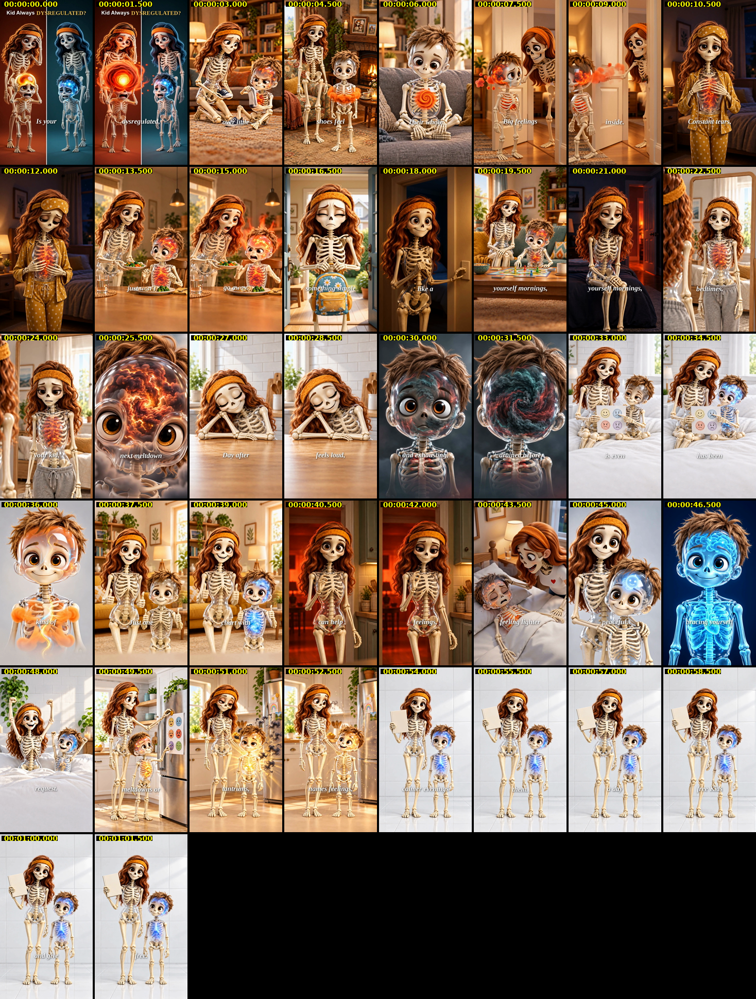

# Storyboard & Approval Package — KMH-V1-INS-20785b5fa6bd · v1.0

| Field | Value |
|---|---|
| Creative ID | KMH-V1-INS-20785b5fa6bd |
| Package version | v1.0 |
| Date | 2026-10-26 |
| Product | Kids Mental Health Bundle (offer: "FREE Kids Mental Health Bundle" / "free today") |
| Selected variation | V1 — "Is your kid always dysregulated?" (#1 BEST BET) |
| Format | 9:16 vertical, 55.055 s, 27 shots, hard cuts; English VO + burned-in captions |
| Reference | INS-20785b5fa6bd (`inspiration-breakdowns/INS-20785b5fa6bd-breakdown.md`) |
| Upstream | `adaptations/INS-20785b5fa6bd-KMH-adaptation.md` (Skill 2) · `adaptations/INS-20785b5fa6bd-KMH-V1-full-script.md` (V1 full script v1.0) |
| Production route | Kie.ai — Grok Imagine Video 1.5 (preview), 720p, 9:16, image-to-video from the keyframes |
| Editor / strategist | Role labels only — names not supplied |
| **Package readiness** | **Draft video built (`video/KMH-V1-INS-20785b5fa6bd-v1.0-draft.mp4`, 63.15 s). All 28 keyframes and all 27 clips inspected; 12 clips redone on Kie and passed. Not final: VO runs past 55.055 s (see §15) and S27 still shows the plain placeholder book** |
| **Creative decision** | **Awaiting strategist approval** |

> **Draft status:** the V1 draft video is built and checked — see §15 for the file, clip QC, credits and VO timing. Two things keep it from being final: the stock voiceover is ~15 s longer than the 55.055 s edit at natural pace (the draft holds S27 until 63.15 s, and VO lines land up to ~9 s after their shots), and the real bundle cover (ASSET02) still needs to replace the placeholder book on S27.

> **V1 script approval:** the V1 full script v1.0 hasn't been approved yet. This package locks that wording; any change to it creates package v1.1.

---

## 1. Variation Previews

### V1 — ALWAYS DYSREGULATED · #1 BEST BET

| Visual preview | |
|---|---|
|    | Frames (open now): [KF-S01-02](https://d8j0ntlcm91z4.cloudfront.net/user_32e8bfkytljQSHDMWhVAG6GkvLR/hf_20261026_104429_85445212-2532-421c-b9c3-fdf3c664da0c.png) · [KF-S17-01](https://d8j0ntlcm91z4.cloudfront.net/user_32e8bfkytljQSHDMWhVAG6GkvLR/hf_20261026_104622_1e362b03-7da5-4343-b056-b6a8d312caf3.png) · [KF-S27-01](https://d8j0ntlcm91z4.cloudfront.net/user_32e8bfkytljQSHDMWhVAG6GkvLR/hf_20261026_104734_dbf3ca89-17c1-4426-ab4e-5a5f5ffbabf4.png) |
| Audio preview | `audio/KMH-V1-INS-20785b5fa6bd-v1.0-V1-audio-preview.mp3` (*Preview audio — not final mix*; built by `build_assets.sh`). Raw VO now: [AUD-V1-VO](https://d8j0ntlcm91z4.cloudfront.net/user_32e8bfkytljQSHDMWhVAG6GkvLR/hf_20261026_104831_39679ccf-0636-4e2b-b3ed-d8dd27f03d5a.mp3) |
| Script | **B01 Hook (0:00–0:03)** — Headline "Kid Always DYSREGULATED?" + VO "Is your kid always dysregulated, melting down over little things?" over the split screen. **B02 Product reveal (0:33–0:38)** — VO "Just one printable feelings chart with your kid every day" → "can help them name feelings," (mom and kid with the chart; light path clears the storm). **B03 CTA (0:54–0:55)** — VO "Grab yours free." (mom holds up the bundle). |
| Angle | Dysregulated Kid — self-identification question |
| Persona | Mom raising kids, 35-44 ("Overwhelmed Olivia") |
| Why we're using it | • KM-388-INS-130 (Dysregulated Kids): $1,699 → 1.13 ROAS, $12.97 per sale • Women 35-44 = 39.3% of sales on 35.8% of spend • Research: "…waiting for the next explosion to occur, usually over something small." |

### V2 — MOM BARELY HOLDING ON · #2 STRONG

| Visual preview | |
|---|---|
|    | Frames (open now): [PV-V2-01](https://d8j0ntlcm91z4.cloudfront.net/user_32e8bfkytljQSHDMWhVAG6GkvLR/hf_20261026_104735_b522bcde-4987-491b-b995-0be78e71cda7.png) · [PV-V2-02](https://d8j0ntlcm91z4.cloudfront.net/user_32e8bfkytljQSHDMWhVAG6GkvLR/hf_20261026_104733_1b5bab57-bc35-4cd5-8b33-3eea395518cf.png) · [KF-S27-01](https://d8j0ntlcm91z4.cloudfront.net/user_32e8bfkytljQSHDMWhVAG6GkvLR/hf_20261026_104734_dbf3ca89-17c1-4426-ab4e-5a5f5ffbabf4.png) |
| Audio preview | `audio/KMH-V1-INS-20785b5fa6bd-v1.0-V2-audio-preview.mp3` (*Preview audio — not final mix*; built by `build_assets.sh`). Raw VO now: [AUD-V2-VO](https://d8j0ntlcm91z4.cloudfront.net/user_32e8bfkytljQSHDMWhVAG6GkvLR/hf_20261026_104832_b1f4d202-a5c7-4447-a3d4-5ede1d927128.mp3) |
| Script | **B01 Hook (0:00–0:03)** — Headline "Losing Your CALM?" + VO "Is your kid always dysregulated, and you're barely holding on?" **B02 Product reveal (0:33–0:38)** — VO "Just five minutes of coping skills together every single day" → "can help you both reset," **B03 CTA (0:54–0:55)** — VO "Grab yours free." (same CTA frame as V1) |
| Angle | Dysregulated Kid — co-regulation (calm mom, calm kid) |
| Persona | Mom raising kids, 35-44, who never learned these skills herself |
| Why we're using it | • KM-324-INS-072 (co-regulation): $961 → 1.06 ROAS • Top pain, 92 upvotes: "I have zero emotional regulation skills and it's messing my son (4) up." |

### V3 — EVERY TIME PLANS CHANGE · #3 SOLID

| Visual preview | |
|---|---|
|    | Frames (open now): [PV-V3-01](https://d8j0ntlcm91z4.cloudfront.net/user_32e8bfkytljQSHDMWhVAG6GkvLR/hf_20261026_104734_65553375-f166-4958-b743-7cbbbede15cc.png) · [PV-V3-02](https://d8j0ntlcm91z4.cloudfront.net/user_32e8bfkytljQSHDMWhVAG6GkvLR/hf_20261026_104735_97b1aff4-b88a-452e-ab73-7c278455ab27.png) · [KF-S27-01](https://d8j0ntlcm91z4.cloudfront.net/user_32e8bfkytljQSHDMWhVAG6GkvLR/hf_20261026_104734_dbf3ca89-17c1-4426-ab4e-5a5f5ffbabf4.png) |
| Audio preview | `audio/KMH-V1-INS-20785b5fa6bd-v1.0-V3-audio-preview.mp3` (*Preview audio — not final mix*; built by `build_assets.sh`). Raw VO now: [AUD-V3-VO](https://d8j0ntlcm91z4.cloudfront.net/user_32e8bfkytljQSHDMWhVAG6GkvLR/hf_20261026_104834_a2a051c8-c1fd-444b-bac9-1e63816f095c.mp3) |
| Script | **B01 Hook (0:00–0:03)** — Headline "Always Melting DOWN?" + VO "Every time plans change, it starts with a little meltdown." **B02 Product reveal (0:33–0:38)** — VO "Just one printable feelings thermometer on the fridge every morning" → "can help them notice feelings," **B03 CTA (0:54–0:55)** — VO "Grab yours free." (same CTA frame as V1) |
| Angle | Dysregulated Kid — everyday-trigger story |
| Persona | Mom raising kids, 35-44 |
| Why we're using it | • KM-525-INS-029 (narrated mom story): 33.2% hook / 16.5% hold, 1.08 ROAS — the only video in the sweet spot • Very-high-hook videos (46–58%) hold only 4.6–7.8% and make 0.69–0.95 ROAS |

---

## 2. Concept summary

- **Test:** first narrated, story-driven "dysregulated kid" video aimed at moms 35-44, built on the reference ad's 55-second structure (problem 60% → "what if" turn → daily-habit product intro → "No more" contrast → payoff → 3-word CTA).
- **Why:** dysregulated-kid is the best-ROAS angle (KM-388 1.13, KM-324 1.06); women 35-44 are 39.3% of sales; mom-briefed concepts so far used ADHD/POV hooks and underperformed (KM-420 0.33, KM-437 0.25, KM-530 0.82).
- **Offer:** "the free Kids Mental Health Bundle" (A19) + CTA "Grab yours free." Disclose any processing fee at checkout.
- **Claims:** "can help them name feelings", "lighter and more peaceful", "calmer evenings" — no diagnosis, ADHD, treatment or cure language.

---

## 3. Keyframe contact sheet

| Shot | Time (s) | Keyframe | VO in this shot |
|---|---|---|---|
| S01 | 0.000–2.703 |  [KF-S01-01](https://d8j0ntlcm91z4.cloudfront.net/user_32e8bfkytljQSHDMWhVAG6GkvLR/hf_20261026_104527_f47d37ef-12ed-47a8-9d2f-61a9adb443c2.png)  [KF-S01-02](https://d8j0ntlcm91z4.cloudfront.net/user_32e8bfkytljQSHDMWhVAG6GkvLR/hf_20261026_104429_85445212-2532-421c-b9c3-fdf3c664da0c.png) | Is your kid always dysregulated, melting down over little things? |
| S02 | 2.703–4.204 |  [KF-S02-01](https://d8j0ntlcm91z4.cloudfront.net/user_32e8bfkytljQSHDMWhVAG6GkvLR/hf_20261026_104429_47c8b092-393c-4142-a2d8-479532e8f694.png) | Then the shoes feel wrong. |
| S03 | 4.204–5.939 |  [KF-S03-01](https://d8j0ntlcm91z4.cloudfront.net/user_32e8bfkytljQSHDMWhVAG6GkvLR/hf_20261026_104428_e86334aa-410f-4145-b5c5-f1c62952b36d.png) | Their whole body goes rigid. |
| S04 | 5.939–8.008 |  [KF-S04-01](https://d8j0ntlcm91z4.cloudfront.net/user_32e8bfkytljQSHDMWhVAG6GkvLR/hf_20261026_104430_04e6a546-77c3-48df-bf92-ff7aed426929.png) | Big feelings get trapped inside. |
| S05 | 8.008–10.277 |  [KF-S05-01](https://d8j0ntlcm91z4.cloudfront.net/user_32e8bfkytljQSHDMWhVAG6GkvLR/hf_20261026_104430_904c8b6b-3cf9-453d-957a-04d826a7d45c.png) | Constant tears, slamming doors. And that |
| S06 | 10.277–12.813 |  [KF-S06-01](https://d8j0ntlcm91z4.cloudfront.net/user_32e8bfkytljQSHDMWhVAG6GkvLR/hf_20261026_104528_92cece3f-22f0-439e-8773-3fdeac4538f2.png) | tense feeling just won't go away. |
| S07 | 12.813–16.450 |  [KF-S07-01](https://d8j0ntlcm91z4.cloudfront.net/user_32e8bfkytljQSHDMWhVAG6GkvLR/hf_20261026_104429_3efd5aad-a20b-4ad6-9b32-a34fb176ac5c.png) | Soon, asking for something simple starts feeling like a risk. |
| S08 | 16.450–18.051 |  [KF-S08-01](https://d8j0ntlcm91z4.cloudfront.net/user_32e8bfkytljQSHDMWhVAG6GkvLR/hf_20261026_104527_cfa574a0-f185-4c8e-b805-0f71df1c3a47.png) | You brace yourself mornings, |
| S09 | 18.051–18.685 |  [KF-S09-01](https://d8j0ntlcm91z4.cloudfront.net/user_32e8bfkytljQSHDMWhVAG6GkvLR/hf_20261026_104529_6c778500-8cd6-4ace-9a89-445f8c3b9a35.png) | dinners, |
| S10 | 18.685–19.386 |  [KF-S10-01](https://d8j0ntlcm91z4.cloudfront.net/user_32e8bfkytljQSHDMWhVAG6GkvLR/hf_20261026_104430_f3ccaa5a-3a5a-4559-8c8a-6dd3869a34d4.png) | bedtimes. |
| S11 | 19.386–21.021 |  [KF-S11-01](https://d8j0ntlcm91z4.cloudfront.net/user_32e8bfkytljQSHDMWhVAG6GkvLR/hf_20261026_104428_67b0321d-f4db-4ece-88d4-9a6b2e5cd6a5.png) | And instead of enjoying your kid, |
| S12 | 21.021–23.157 |  [KF-S12-01](https://d8j0ntlcm91z4.cloudfront.net/user_32e8bfkytljQSHDMWhVAG6GkvLR/hf_20261026_104527_53592ea6-c0b0-49ec-864c-78b5787fbd6c.png) | you're waiting for the next meltdown to start. |
| S13 | 23.157–25.826 |  [KF-S13-01](https://d8j0ntlcm91z4.cloudfront.net/user_32e8bfkytljQSHDMWhVAG6GkvLR/hf_20261026_104527_c16f8b96-7171-49b6-9364-9425e64565ae.png) | Day after day, your home feels loud, |
| S14 | 25.826–27.728 |  [KF-S14-01](https://d8j0ntlcm91z4.cloudfront.net/user_32e8bfkytljQSHDMWhVAG6GkvLR/hf_20261026_104622_06a0fc6e-8db0-49fb-bbde-6d19cba40acf.png) | tense, and exhausting, |
| S15 | 27.728–30.297 |  [KF-S15-01](https://d8j0ntlcm91z4.cloudfront.net/user_32e8bfkytljQSHDMWhVAG6GkvLR/hf_20261026_104622_31fc4e7e-2150-40ef-b4ed-6a0347acb280.png) | leaving you drained before your day is even over. |
| S16 | 30.297–33.300 |  [KF-S16-01](https://d8j0ntlcm91z4.cloudfront.net/user_32e8bfkytljQSHDMWhVAG6GkvLR/hf_20261026_104623_0648d1d8-562d-4514-8df5-316a1624ebe6.png) | What if your kid has been asking for a different kind of support? |
| S17 | 33.300–35.836 |  [KF-S17-01](https://d8j0ntlcm91z4.cloudfront.net/user_32e8bfkytljQSHDMWhVAG6GkvLR/hf_20261026_104622_1e362b03-7da5-4343-b056-b6a8d312caf3.png) | Just one printable feelings chart with your kid every day |
| S18 | 35.836–37.971 |  [KF-S18-01](https://d8j0ntlcm91z4.cloudfront.net/user_32e8bfkytljQSHDMWhVAG6GkvLR/hf_20261026_104622_ee70d886-456e-4664-a551-7d430d9a5146.png) | can help them name feelings, |
| S19 | 37.971–40.607 |  [KF-S19-01](https://d8j0ntlcm91z4.cloudfront.net/user_32e8bfkytljQSHDMWhVAG6GkvLR/hf_20261026_104621_3aa4e6ee-14ae-427e-91bd-75ff27c2b7aa.png) | and leave your home feeling lighter and more peaceful. |
| S20 | 40.607–42.843 |  [KF-S20-01](https://d8j0ntlcm91z4.cloudfront.net/user_32e8bfkytljQSHDMWhVAG6GkvLR/hf_20261026_104658_b21b9325-de58-4bfe-bcfa-7c80853978fa.png) | No more bracing yourself before every request. |
| S21 | 42.843–45.078 |  [KF-S21-01](https://d8j0ntlcm91z4.cloudfront.net/user_32e8bfkytljQSHDMWhVAG6GkvLR/hf_20261026_104656_5d7c1602-3f94-43c7-84b1-64b726f888ac.png) | No more worrying about meltdowns or tantrums, |
| S22 | 45.078–46.246 |  [KF-S22-01](https://d8j0ntlcm91z4.cloudfront.net/user_32e8bfkytljQSHDMWhVAG6GkvLR/hf_20261026_104657_16b7aebe-3433-4ee6-b61c-0fe3d9889b65.png) | just a kid who names feelings, |
| S23 | 46.246–47.547 |  [KF-S23-01](https://d8j0ntlcm91z4.cloudfront.net/user_32e8bfkytljQSHDMWhVAG6GkvLR/hf_20261026_104657_c0814c1e-774f-4767-b90b-d5dab53501ce.png) | calmer evenings |
| S24 | 47.547–49.249 |  [KF-S24-01](https://d8j0ntlcm91z4.cloudfront.net/user_32e8bfkytljQSHDMWhVAG6GkvLR/hf_20261026_104658_6fff6527-1832-4ea9-a7dc-ebb7ade626ef.png) | and time to enjoy them. |
| S25 | 49.249–51.485 |  [KF-S25-01](https://d8j0ntlcm91z4.cloudfront.net/user_32e8bfkytljQSHDMWhVAG6GkvLR/hf_20261026_104658_9aac50a2-96d2-4a62-a99a-e86796bdc350.png) | Add one feelings chart a day from the free Kids Mental Health Bundle |
| S26 | 51.485–53.887 |  [KF-S26-01](https://d8j0ntlcm91z4.cloudfront.net/user_32e8bfkytljQSHDMWhVAG6GkvLR/hf_20261026_104734_dbfbff88-5adb-4750-b4b6-aebfe8048c46.png) | and give your kid support. |
| S27 | 53.887–55.055 |  [KF-S27-01](https://d8j0ntlcm91z4.cloudfront.net/user_32e8bfkytljQSHDMWhVAG6GkvLR/hf_20261026_104734_dbf3ca89-17c1-4426-ab4e-5a5f5ffbabf4.png) | Grab yours free. |

---

## 4. Timecoded storyboard (V1)

Intervals are start-inclusive / end-exclusive, on the reference's frame-verified cut times (29.97 fps). VO timings are **planned**; the preview TTS length must be checked against them (see §6).

### S01 · 0.000–2.703 s (~2.70 s) · B01 Hook

| | |
|---|---|
| Keyframes |   KF-S01-01 ([KF-S01-01](https://d8j0ntlcm91z4.cloudfront.net/user_32e8bfkytljQSHDMWhVAG6GkvLR/hf_20261026_104527_f47d37ef-12ed-47a8-9d2f-61a9adb443c2.png)) · KF-S01-02 ([KF-S01-02](https://d8j0ntlcm91z4.cloudfront.net/user_32e8bfkytljQSHDMWhVAG6GkvLR/hf_20261026_104429_85445212-2532-421c-b9c3-fdf3c664da0c.png)) |
| VO (A01 + V01) | "Is your kid always dysregulated, melting down over little things?" (10 words) |
| On-screen text | Headline "Kid Always DYSREGULATED?" (top ~10%, 0.000–2.703) + captions: Is your / kid always / dysregulated, / melting down / over little / things? |
| Action | Static split screen. Left: kid's head glow grows small yellow → large red-orange storm while mom hunches, hand on forehead. Right: calm mom and kid, faint blue glow. |
| Camera | Locked-off, no movement. |
| End state | Large red storm in left kid's head; right side unchanged. |
| Transition | open → hard cut out |
| Prompts | IMG-S01-01, IMG-S01-02 · VID-S01-01 |
| Reference shot replaced | Split-screen X-ray, belly glow growing |
| Assets | ASSET01 (character reference) |

### S02 · 2.703–4.204 s (~1.50 s) · B02 Escalation

| | |
|---|---|
| Keyframes |  KF-S02-01 ([KF-S02-01](https://d8j0ntlcm91z4.cloudfront.net/user_32e8bfkytljQSHDMWhVAG6GkvLR/hf_20261026_104429_47c8b092-393c-4142-a2d8-479532e8f694.png)) |
| VO (A02) | "Then the shoes feel wrong." (5 words) |
| On-screen text | captions: Then the / shoes feel / wrong. |
| Action | Kid tugs at shoe and sock, face scrunches; mom kneels holding the other shoe. |
| Camera | Static medium shot, slight handheld drift. |
| End state | Kid still struggling with the shoe. |
| Transition | hard cut in → hard cut out |
| Prompts | IMG-S02-01 · VID-S02-01 |
| Reference shot replaced | Jeans won't close |
| Assets | ASSET01 (character reference) |

### S03 · 4.204–5.939 s (~1.74 s) · B02 Escalation

| | |
|---|---|
| Keyframes |  KF-S03-01 ([KF-S03-01](https://d8j0ntlcm91z4.cloudfront.net/user_32e8bfkytljQSHDMWhVAG6GkvLR/hf_20261026_104428_e86334aa-410f-4145-b5c5-f1c62952b36d.png)) |
| VO (A03) | "Their whole body goes rigid." (5 words) |
| On-screen text | captions: Their whole / body goes / rigid. |
| Action | Kid stiffens, arms lock at sides, fists clench; chest storm pulses. |
| Camera | Static medium-wide, slightly high angle. |
| End state | Kid rigid, storm visible in chest. |
| Transition | hard cut in → hard cut out |
| Prompts | IMG-S03-01 · VID-S03-01 |
| Reference shot replaced | Hard belly in armchair |
| Assets | ASSET01 (character reference) |

### S04 · 5.939–8.008 s (~2.07 s) · B02 Escalation

| | |
|---|---|
| Keyframes |  KF-S04-01 ([KF-S04-01](https://d8j0ntlcm91z4.cloudfront.net/user_32e8bfkytljQSHDMWhVAG6GkvLR/hf_20261026_104430_04e6a546-77c3-48df-bf92-ff7aed426929.png)) |
| VO (A04) | "Big feelings get trapped inside." (5 words) |
| On-screen text | captions: Big feelings / get trapped / inside. |
| Action | Red-orange storm thickens and presses against the ribs inside the translucent chest. |
| Camera | Static; very slow push-in. |
| End state | Chest full of storm. |
| Transition | hard cut in → hard cut out |
| Prompts | IMG-S04-01 · VID-S04-01 |
| Reference shot replaced | Green gas fills torso |
| Assets | ASSET01 (character reference) |

### S05 · 8.008–10.277 s (~2.27 s) · B03 Escalation

| | |
|---|---|
| Keyframes |  KF-S05-01 ([KF-S05-01](https://d8j0ntlcm91z4.cloudfront.net/user_32e8bfkytljQSHDMWhVAG6GkvLR/hf_20261026_104430_904c8b6b-3cf9-453d-957a-04d826a7d45c.png)) |
| VO (A05 + start of A06) | "Constant tears, slamming doors. And that" (6 words) |
| On-screen text | captions: Constant tears, / slamming doors. / And that |
| Action | Kid walks off in tears; bedroom door swings shut; small storm puffs drift from the head. |
| Camera | Static side profile. |
| End state | Door closed, storm puffs fading. |
| Transition | hard cut in → hard cut out |
| Prompts | IMG-S05-01 · VID-S05-01 |
| Reference shot replaced | Passing gas in armchair |
| Assets | ASSET01 (character reference) |

### S06 · 10.277–12.813 s (~2.54 s) · B03 Persistence

| | |
|---|---|
| Keyframes |  KF-S06-01 ([KF-S06-01](https://d8j0ntlcm91z4.cloudfront.net/user_32e8bfkytljQSHDMWhVAG6GkvLR/hf_20261026_104528_92cece3f-22f0-439e-8773-3fdeac4538f2.png)) |
| VO (A06 (rest)) | "tense feeling just won't go away." (6 words) |
| On-screen text | captions: tense feeling / just won't / go away. |
| Action | Mom in pyjamas at night rubs her own chest; faint storm glow in her chest. |
| Camera | Static frontal medium shot. |
| End state | Mom still, tired. |
| Transition | hard cut in → hard cut out |
| Prompts | IMG-S06-01 · VID-S06-01 |
| Reference shot replaced | Pyjamas at bedtime |
| Assets | ASSET01 (character reference) |

### S07 · 12.813–16.450 s (~3.64 s) · B04 Life impact

| | |
|---|---|
| Keyframes |  KF-S07-01 ([KF-S07-01](https://d8j0ntlcm91z4.cloudfront.net/user_32e8bfkytljQSHDMWhVAG6GkvLR/hf_20261026_104429_3efd5aad-a20b-4ad6-9b32-a34fb176ac5c.png)) |
| VO (A07) | "Soon, asking for something simple starts feeling like a risk." (10 words) |
| On-screen text | captions: Soon, / asking for / something simple / starts feeling / like a / risk. |
| Action | Mom offers a plate of vegetables; kid's head storm flares; mom freezes mid-gesture. |
| Camera | Static, slightly low angle across the table. |
| End state | Mom frozen, plate held out. |
| Transition | hard cut in → hard cut out |
| Prompts | IMG-S07-01 · VID-S07-01 |
| Reference shot replaced | Feast table |
| Assets | ASSET01 (character reference) |

### S08 · 16.450–18.051 s (~1.60 s) · B04 Life impact (list)

| | |
|---|---|
| Keyframes |  KF-S08-01 ([KF-S08-01](https://d8j0ntlcm91z4.cloudfront.net/user_32e8bfkytljQSHDMWhVAG6GkvLR/hf_20261026_104527_cfa574a0-f185-4c8e-b805-0f71df1c3a47.png)) |
| VO (A08 part 1) | "You brace yourself mornings," (4 words) |
| On-screen text | captions: You brace / yourself mornings, |
| Action | Mom at the front door with a backpack, eyes closed, shoulders rising. |
| Camera | Static medium shot. |
| End state | Mom bracing. |
| Transition | hard cut in → hard cut out |
| Prompts | IMG-S08-01 · VID-S08-01 |
| Reference shot replaced | Chin-in-hand armchair |
| Assets | ASSET01 (character reference) |

### S09 · 18.051–18.685 s (~0.63 s) · B04 Life impact (list)

| | |
|---|---|
| Keyframes |  KF-S09-01 ([KF-S09-01](https://d8j0ntlcm91z4.cloudfront.net/user_32e8bfkytljQSHDMWhVAG6GkvLR/hf_20261026_104529_6c778500-8cd6-4ace-9a89-445f8c3b9a35.png)) |
| VO (A08 part 2) | "dinners," (1 words) |
| On-screen text | captions: dinners, |
| Action | Mom sets plates, glances nervously at the kid's glowing head behind. |
| Camera | Static; quick cut. |
| End state | Mom mid-glance. |
| Transition | hard cut in → hard cut out |
| Prompts | IMG-S09-01 · VID-S09-01 |
| Reference shot replaced | Street walk |
| Assets | ASSET01 (character reference) |

### S10 · 18.685–19.386 s (~0.70 s) · B04 Life impact (list)

| | |
|---|---|
| Keyframes |  KF-S10-01 ([KF-S10-01](https://d8j0ntlcm91z4.cloudfront.net/user_32e8bfkytljQSHDMWhVAG6GkvLR/hf_20261026_104430_f3ccaa5a-3a5a-4559-8c8a-6dd3869a34d4.png)) |
| VO (A08 part 3) | "bedtimes." (1 words) |
| On-screen text | captions: bedtimes. |
| Action | Mom at the kid's bedroom door, hand on the light switch, bracing. |
| Camera | Static; quick cut. |
| End state | Mom bracing at the door. |
| Transition | hard cut in → hard cut out |
| Prompts | IMG-S10-01 · VID-S10-01 |
| Reference shot replaced | Laptop 'working' |
| Assets | ASSET01 (character reference) |

### S11 · 19.386–21.021 s (~1.64 s) · B04 Life impact

| | |
|---|---|
| Keyframes |  KF-S11-01 ([KF-S11-01](https://d8j0ntlcm91z4.cloudfront.net/user_32e8bfkytljQSHDMWhVAG6GkvLR/hf_20261026_104428_67b0321d-f4db-4ece-88d4-9a6b2e5cd6a5.png)) |
| VO (A09 part 1) | "And instead of enjoying your kid," (6 words) |
| On-screen text | captions: And instead / of enjoying / your kid, |
| Action | Board game set up; mom watches the kid warily instead of playing. |
| Camera | Static medium shot. |
| End state | Mom watching. |
| Transition | hard cut in → hard cut out |
| Prompts | IMG-S11-01 · VID-S11-01 |
| Reference shot replaced | Meal not eaten |
| Assets | ASSET01 (character reference) |

### S12 · 21.021–23.157 s (~2.14 s) · B04 Life impact

| | |
|---|---|
| Keyframes |  KF-S12-01 ([KF-S12-01](https://d8j0ntlcm91z4.cloudfront.net/user_32e8bfkytljQSHDMWhVAG6GkvLR/hf_20261026_104527_53592ea6-c0b0-49ec-864c-78b5787fbd6c.png)) |
| VO (A09 part 2) | "you're waiting for the next meltdown to start." (8 words) |
| On-screen text | captions: you're waiting / for the / next meltdown / to start. |
| Action | Mom on the edge of a dark bed, hands clasped, waiting; red glow through the doorway. |
| Camera | Static frontal. |
| End state | Mom waiting. |
| Transition | hard cut in → hard cut out |
| Prompts | IMG-S12-01 · VID-S12-01 |
| Reference shot replaced | Waiting on bed edge |
| Assets | ASSET01 (character reference) |

### S13 · 23.157–25.826 s (~2.67 s) · B05 Low point

| | |
|---|---|
| Keyframes |  KF-S13-01 ([KF-S13-01](https://d8j0ntlcm91z4.cloudfront.net/user_32e8bfkytljQSHDMWhVAG6GkvLR/hf_20261026_104527_c16f8b96-7171-49b6-9364-9425e64565ae.png)) |
| VO (A10 part 1) | "Day after day, your home feels loud," (7 words) |
| On-screen text | captions: Day after / day, / your home / feels loud, |
| Action | Over-the-shoulder mirror shot; exhausted reflection with faint chest storm. |
| Camera | Near-static, slight push. |
| End state | Mom looking at reflection. |
| Transition | hard cut in → hard cut out |
| Prompts | IMG-S13-01 · VID-S13-01 |
| Reference shot replaced | Mirror, bloated belly |
| Assets | ASSET01 (character reference) |

### S14 · 25.826–27.728 s (~1.90 s) · B05 Low point

| | |
|---|---|
| Keyframes |  KF-S14-01 ([KF-S14-01](https://d8j0ntlcm91z4.cloudfront.net/user_32e8bfkytljQSHDMWhVAG6GkvLR/hf_20261026_104622_06a0fc6e-8db0-49fb-bbde-6d19cba40acf.png)) |
| VO (A10 part 2) | "tense, and exhausting," (3 words) |
| On-screen text | captions: tense, / and exhausting, |
| Action | Inside the kid's head: storm clouds swirl, tiny lightning flickers. |
| Camera | Slow drift through the clouds. |
| End state | Storm still churning. |
| Transition | hard cut in → hard cut out |
| Prompts | IMG-S14-01 · VID-S14-01 |
| Reference shot replaced | Inside-gut bubbles |
| Assets | ASSET01 (character reference) |

### S15 · 27.728–30.297 s (~2.57 s) · B05 Low point

| | |
|---|---|
| Keyframes |  KF-S15-01 ([KF-S15-01](https://d8j0ntlcm91z4.cloudfront.net/user_32e8bfkytljQSHDMWhVAG6GkvLR/hf_20261026_104622_31fc4e7e-2150-40ef-b4ed-6a0347acb280.png)) |
| VO (A11) | "leaving you drained before your day is even over." (9 words) |
| On-screen text | captions: leaving you / drained before / your day / is even / over. |
| Action | Mom rests her head on folded arms on the counter, eyes closed. |
| Camera | Static medium close-up. |
| End state | Mom still, exhausted. |
| Transition | hard cut in → hard cut out |
| Prompts | IMG-S15-01 · VID-S15-01 |
| Reference shot replaced | Head down on counter |
| Assets | ASSET01 (character reference) |

### S16 · 30.297–33.300 s (~3.00 s) · B06 Turn

| | |
|---|---|
| Keyframes |  KF-S16-01 ([KF-S16-01](https://d8j0ntlcm91z4.cloudfront.net/user_32e8bfkytljQSHDMWhVAG6GkvLR/hf_20261026_104623_0648d1d8-562d-4514-8df5-316a1624ebe6.png)) |
| VO (A12 (H04)) | "What if your kid has been asking for a different kind of support?" (13 words) |
| On-screen text | captions: What if / your kid / has been / asking for / a different / kind of / support? |
| Action | Dense dark storm swirls slowly inside the kid's head, heavy and trapped. |
| Camera | Very slow push-in. |
| End state | Darkest frame. |
| Transition | hard cut in → hard cut out |
| Prompts | IMG-S16-01 · VID-S16-01 |
| Reference shot replaced | Dark gut with creatures |
| Assets | ASSET01 (character reference) |

### S17 · 33.300–35.836 s (~2.54 s) · B07 Product as daily habit

| | |
|---|---|
| Keyframes |  KF-S17-01 ([KF-S17-01](https://d8j0ntlcm91z4.cloudfront.net/user_32e8bfkytljQSHDMWhVAG6GkvLR/hf_20261026_104622_1e362b03-7da5-4343-b056-b6a8d312caf3.png)) |
| VO (A13) | "Just one printable feelings chart with your kid every day" (10 words) |
| On-screen text | captions: Just one / printable feelings / chart with / your kid / every day |
| Action | Mom and kid on a white bed with a printed feelings chart; kid points at a face; faint blue glow starts. |
| Camera | Static, high angle. |
| End state | Kid pointing, blue glow present. |
| Transition | hard cut in → hard cut out |
| Prompts | IMG-S17-01 · VID-S17-01 |
| Reference shot replaced | Dropper in navel |
| Assets | ASSET01 (character reference); ASSET02 (real bundle cover — **missing**) |

### S18 · 35.836–37.971 s (~2.13 s) · B08 How it works

| | |
|---|---|
| Keyframes |  KF-S18-01 ([KF-S18-01](https://d8j0ntlcm91z4.cloudfront.net/user_32e8bfkytljQSHDMWhVAG6GkvLR/hf_20261026_104622_ee70d886-456e-4664-a551-7d430d9a5146.png)) |
| VO (A14) | "can help them name feelings," (5 words) |
| On-screen text | captions: can help / them name / feelings, |
| Action | A gold-blue light path travels from the eyes through the storm, which thins. |
| Camera | Slow pull-back to the head silhouette. |
| End state | Storm thinning, path lit. |
| Transition | hard cut in → hard cut out |
| Prompts | IMG-S18-01 · VID-S18-01 |
| Reference shot replaced | Glowing path through organs |
| Assets | ASSET01 (character reference) |

### S19 · 37.971–40.607 s (~2.64 s) · B09 Outcome

| | |
|---|---|
| Keyframes |  KF-S19-01 ([KF-S19-01](https://d8j0ntlcm91z4.cloudfront.net/user_32e8bfkytljQSHDMWhVAG6GkvLR/hf_20261026_104621_3aa4e6ee-14ae-427e-91bd-75ff27c2b7aa.png)) |
| VO (A15) | "and leave your home feeling lighter and more peaceful." (9 words) |
| On-screen text | captions: and leave / your home / feeling lighter / and more / peaceful. |
| Action | Mom and kid smile, double thumbs up; kid's head glows calm blue. |
| Camera | Static frontal, small bounce. |
| End state | Both smiling. |
| Transition | hard cut in → hard cut out |
| Prompts | IMG-S19-01 · VID-S19-01 |
| Reference shot replaced | Thumbs up |
| Assets | ASSET01 (character reference) |

### S20 · 40.607–42.843 s (~2.24 s) · B09 'No more' contrast

| | |
|---|---|
| Keyframes |  KF-S20-01 ([KF-S20-01](https://d8j0ntlcm91z4.cloudfront.net/user_32e8bfkytljQSHDMWhVAG6GkvLR/hf_20261026_104658_b21b9325-de58-4bfe-bcfa-7c80853978fa.png)) |
| VO (A16) | "No more bracing yourself before every request." (7 words) |
| On-screen text | captions: No more / bracing yourself / before every / request. |
| Action | Old state: mom tense in the kitchen doorway about to ask; red glow behind. |
| Camera | Static. |
| End state | Mom hesitating. |
| Transition | hard cut in → hard cut out |
| Prompts | IMG-S20-01 · VID-S20-01 |
| Reference shot replaced | Desk, negative state |
| Assets | ASSET01 (character reference) |

### S21 · 42.843–45.078 s (~2.23 s) · B09 'No more' contrast

| | |
|---|---|
| Keyframes |  KF-S21-01 ([KF-S21-01](https://d8j0ntlcm91z4.cloudfront.net/user_32e8bfkytljQSHDMWhVAG6GkvLR/hf_20261026_104656_5d7c1602-3f94-43c7-84b1-64b726f888ac.png)) |
| VO (A17) | "No more worrying about meltdowns or tantrums," (7 words) |
| On-screen text | captions: No more / worrying about / meltdowns or / tantrums, |
| Action | Old state: kid wide-eyed in bed, storm swirling. |
| Camera | Static, high angle. |
| End state | Kid worried. |
| Transition | hard cut in → hard cut out |
| Prompts | IMG-S21-01 · VID-S21-01 |
| Reference shot replaced | Bed, green fluid |
| Assets | ASSET01 (character reference) |

### S22 · 45.078–46.246 s (~1.17 s) · B09 Benefits (list)

| | |
|---|---|
| Keyframes |  KF-S22-01 ([KF-S22-01](https://d8j0ntlcm91z4.cloudfront.net/user_32e8bfkytljQSHDMWhVAG6GkvLR/hf_20261026_104657_16b7aebe-3433-4ee6-b61c-0fe3d9889b65.png)) |
| VO (A18 part 1) | "just a kid who names feelings," (6 words) |
| On-screen text | captions: just a / kid who / names feelings, |
| Action | Inside the kid's head: calm blue light, a small glowing smiley shape. |
| Camera | Static; gentle float. |
| End state | Calm interior. |
| Transition | hard cut in → hard cut out |
| Prompts | IMG-S22-01 · VID-S22-01 |
| Reference shot replaced | Clean intestines |
| Assets | ASSET01 (character reference) |

### S23 · 46.246–47.547 s (~1.30 s) · B09 Benefits (list)

| | |
|---|---|
| Keyframes |  KF-S23-01 ([KF-S23-01](https://d8j0ntlcm91z4.cloudfront.net/user_32e8bfkytljQSHDMWhVAG6GkvLR/hf_20261026_104657_c0814c1e-774f-4767-b90b-d5dab53501ce.png)) |
| VO (A18 part 2) | "calmer evenings" (2 words) |
| On-screen text | captions: calmer evenings |
| Action | Blue X-ray of kid's head and chest glowing steady cyan. |
| Camera | Static. |
| End state | Steady glow. |
| Transition | hard cut in → hard cut out |
| Prompts | IMG-S23-01 · VID-S23-01 |
| Reference shot replaced | Blue X-ray tract |
| Assets | ASSET01 (character reference) |

### S24 · 47.547–49.249 s (~1.70 s) · B09 Benefits (list)

| | |
|---|---|
| Keyframes |  KF-S24-01 ([KF-S24-01](https://d8j0ntlcm91z4.cloudfront.net/user_32e8bfkytljQSHDMWhVAG6GkvLR/hf_20261026_104658_6fff6527-1832-4ea9-a7dc-ebb7ade626ef.png)) |
| VO (A18 part 3) | "and time to enjoy them." (5 words) |
| On-screen text | captions: and time / to enjoy / them. |
| Action | Mom and kid in bed laugh and stretch arms overhead, settle. |
| Camera | Static medium shot. |
| End state | Relaxed, smiling. |
| Transition | hard cut in → hard cut out |
| Prompts | IMG-S24-01 · VID-S24-01 |
| Reference shot replaced | Stretching in bed |
| Assets | ASSET01 (character reference) |

### S25 · 49.249–51.485 s (~2.24 s) · B10 Usage repeated + offer

| | |
|---|---|
| Keyframes |  KF-S25-01 ([KF-S25-01](https://d8j0ntlcm91z4.cloudfront.net/user_32e8bfkytljQSHDMWhVAG6GkvLR/hf_20261026_104658_9aac50a2-96d2-4a62-a99a-e86796bdc350.png)) |
| VO (A19 part 1) | "Add one feelings chart a day from the free Kids Mental Health Bundle" (13 words) |
| On-screen text | captions: Add one / feelings chart / a day / from the / free Kids / Mental Health / Bundle |
| Action | Mom pins a chart to the fridge; kid points; gold glow spirals in the kid's chest. |
| Camera | Static medium-full. |
| End state | Chart on fridge, glow spiralling. |
| Transition | hard cut in → hard cut out |
| Prompts | IMG-S25-01 · VID-S25-01 |
| Reference shot replaced | Bathroom dropper ritual |
| Assets | ASSET01 (character reference); ASSET02 (real bundle cover — **missing**) |

### S26 · 51.485–53.887 s (~2.40 s) · B10 Payoff

| | |
|---|---|
| Keyframes |  KF-S26-01 ([KF-S26-01](https://d8j0ntlcm91z4.cloudfront.net/user_32e8bfkytljQSHDMWhVAG6GkvLR/hf_20261026_104734_dbfbff88-5adb-4750-b4b6-aebfe8048c46.png)) |
| VO (A19 part 2) | "and give your kid support." (5 words) |
| On-screen text | captions: and give / your kid / support. |
| Action | Gold light bursts through the kid's head and chest; dark storm wisps break up and float away. |
| Camera | Static (hard cut, same framing). |
| End state | Kid wide-eyed and smiling, clear glow. |
| Transition | hard cut in → hard cut out |
| Prompts | IMG-S26-01 · VID-S26-01 |
| Reference shot replaced | Gold burst expels particles |
| Assets | ASSET01 (character reference) |

### S27 · 53.887–55.055 s (~1.17 s) · B11 CTA

| | |
|---|---|
| Keyframes |  KF-S27-01 ([KF-S27-01](https://d8j0ntlcm91z4.cloudfront.net/user_32e8bfkytljQSHDMWhVAG6GkvLR/hf_20261026_104734_dbf3ca89-17c1-4426-ab4e-5a5f5ffbabf4.png)) |
| VO (A20) | "Grab yours free." (3 words) |
| On-screen text | captions: Grab yours / free. |
| Action | Mom holds up the printed bundle at shoulder height, smiling; kid beside her. Real cover composited in edit. |
| Camera | Static frontal. |
| End state | End frame. |
| Transition | hard cut in → end |
| Prompts | IMG-S27-01 · VID-S27-01 |
| Reference shot replaced | Bottle held up |
| Assets | ASSET01 (character reference); ASSET02 (real bundle cover — **missing**) |

---

## 5. Clean script and on-screen text

**Headline (S01, 0.000–2.703):** Kid Always DYSREGULATED?

**VO:** Is your kid always dysregulated, melting down over little things? Then the shoes feel wrong. Their whole body goes rigid. Big feelings get trapped inside. Constant tears, slamming doors. And that tense feeling just won't go away. Soon, asking for something simple starts feeling like a risk. You brace yourself mornings, dinners, bedtimes. And instead of enjoying your kid, you're waiting for the next meltdown to start. Day after day, your home feels loud, tense, and exhausting, leaving you drained before your day is even over. What if your kid has been asking for a different kind of support? Just one printable feelings chart with your kid every day can help them name feelings, and leave your home feeling lighter and more peaceful. No more bracing yourself before every request. No more worrying about meltdowns or tantrums, just a kid who names feelings, calmer evenings and time to enjoy them. Add one feelings chart a day from the free Kids Mental Health Bundle and give your kid support. Grab yours free.

Total VO: 171 words (reference 171).

**Caption states (1–3 words, white bold italic serif, soft shadow, centred ~74% height):**

- S01: Is your / kid always / dysregulated, / melting down / over little / things?
- S02: Then the / shoes feel / wrong.
- S03: Their whole / body goes / rigid.
- S04: Big feelings / get trapped / inside.
- S05: Constant tears, / slamming doors. / And that
- S06: tense feeling / just won't / go away.
- S07: Soon, / asking for / something simple / starts feeling / like a / risk.
- S08: You brace / yourself mornings,
- S09: dinners,
- S10: bedtimes.
- S11: And instead / of enjoying / your kid,
- S12: you're waiting / for the / next meltdown / to start.
- S13: Day after / day, / your home / feels loud,
- S14: tense, / and exhausting,
- S15: leaving you / drained before / your day / is even / over.
- S16: What if / your kid / has been / asking for / a different / kind of / support?
- S17: Just one / printable feelings / chart with / your kid / every day
- S18: can help / them name / feelings,
- S19: and leave / your home / feeling lighter / and more / peaceful.
- S20: No more / bracing yourself / before every / request.
- S21: No more / worrying about / meltdowns or / tantrums,
- S22: just a / kid who / names feelings,
- S23: calmer evenings
- S24: and time / to enjoy / them.
- S25: Add one / feelings chart / a day / from the / free Kids / Mental Health / Bundle
- S26: and give / your kid / support.
- S27: Grab yours / free.

---

## 6. Counts and reference checks

| Check | Result | Basis |
|---|---|---|
| Headline words | 3 = reference 3 ✅ | verified (token count) |
| Hook VO words | 10 = reference 10 ✅ | verified |
| Total VO words | 171 = reference 171 ✅ | verified |
| CTA words | 3 = reference 3 ✅ | verified |
| Shot count / cut times | 27 shots on the reference cut times ✅ | verified against Skill 1 |
| Total duration | 55.055 s ✅ | verified (planned edit) |
| VO fits 55 s | ❌ **No** — AUD-V1-VO speech runs 0.49–70.81 s (≈2.4 words/s). With pauses between lines capped at 0.35 s it still ends at 62.35 s (+7.3 s past 55.055); draft holds S27 to 63.15 s | measured (silencedetect + Whisper word timings) |
| Keyframe accuracy | ✅ all 28 keyframes on-model and on-brief (KF-S01-01/02 use the blue X-ray split-screen look by design) | inspected |
| Problem/solution split | turn at 30.297, product at 33.300 (60.5%) ✅ | planned |

---

## 7. Visual system and continuity

- **ASSET01 — character reference** ([ASSET01](https://d8j0ntlcm91z4.cloudfront.net/user_32e8bfkytljQSHDMWhVAG6GkvLR/hf_20261026_104155_bb5b081c-04e0-4ae8-baec-61e9afb019fb.png)): mom = slim female cartoon skeleton, ivory bones, long wavy auburn-copper hair, orange-mustard terry headband, large expressive eyes, translucent glass torso shell; kid ≈7, waist-height, short messy light-brown hair, translucent glass head and chest. Attach ASSET01 to every image/video generation.
- **Emotion signal:** red-orange storm cloud with sparks = dysregulated; soft steady blue glow = settled; gold light = the bundle's effect (S25–S26). The storm never shows creatures, gore or violence.
- **Palette:** S01–S16 dim warm amber interiors; S16 darkest teal-grey. S17–S27 bright white bedrooms/kitchen/tile, blue and gold accents.
- **Camera:** static or slow drift; S04/S16 slow push-in; S18 slow pull-back; hard cuts only.
- **Text:** all text is an editor overlay (none baked into images). Headline S01 only: "Kid Always" white bold sans + "DYSREGULATED?" gold bold serif caps, top ~10%. Captions as §5.
- **Product:** ASSET02 real bundle cover is **missing**. S27 shows a plain cream placeholder book; composite the real cover in edit. Worksheets in S17/S25 are generic drawn-face pages; swap for real bundle pages if the strategist wants product truth there too.
- **Audio:** stock synthetic voice "Emily" (Higgsfield Seed Audio preset; not a cloned real voice) — warm, calm female, conversational. Music: soft pad, darker 0–34 s, brighter lift from ~34 s (matches the reference's bed change). No SFX required; optional soft whoosh on S26 burst.

---

## 8. Image prompts (as submitted)

Model: Higgsfield `gpt_image_2_5`, 9:16, quality medium (ASSET01: high), 1k; image reference = ASSET01. Full text also in `prompts/image-prompts.json`.

**IMG-S01-01** (KF-S01-01 · job `f47d37ef-12ed-47a8-9d2f-61a9adb443c2`)

> Photoreal 3D CGI render, stylised animated explainer-ad look, vertical 9:16 frame. Keep the character designs exactly as in the attached reference image. Characters: the MOM: a slim female cartoon skeleton with ivory bones, long wavy auburn-copper hair, an orange-mustard terry-cloth headband, large expressive eyes in the skull, translucent clear glass-like body shell over the torso; the KID (about 7, waist height to mom): a small cartoon skeleton with short messy light-brown hair and a translucent clear glass-like head and chest. Friendly and slightly comic, never scary, no gore, no blood. Hook, first frame. Split screen with a thin vertical white divider down the middle. LEFT half: deep dark-red background, blue translucent X-ray-style render of the mom hunched with a hand on her forehead next to the kid mid-scream; a SMALL yellow glow sits in the kid's head. RIGHT half: dark teal background, the same mom and kid in blue X-ray style standing calm and upright with a faint blue glow in the kid's head. Static, centred, full bodies. Leave the top 12% of the frame empty for a headline. Keep the bottom 30% of the frame free of key detail (captions go there). No text, letters, numbers, logos or watermarks anywhere in the image.

**IMG-S01-02** (KF-S01-02 · job `85445212-2532-421c-b9c3-fdf3c664da0c`)

> Photoreal 3D CGI render, stylised animated explainer-ad look, vertical 9:16 frame. Keep the character designs exactly as in the attached reference image. Characters: the MOM: a slim female cartoon skeleton with ivory bones, long wavy auburn-copper hair, an orange-mustard terry-cloth headband, large expressive eyes in the skull, translucent clear glass-like body shell over the torso; the KID (about 7, waist height to mom): a small cartoon skeleton with short messy light-brown hair and a translucent clear glass-like head and chest. Friendly and slightly comic, never scary, no gore, no blood. Hook, end of shot. Same split screen as before: thin vertical white divider. LEFT half dark-red: blue translucent X-ray-style mom hunched, hand on forehead, the kid screaming; inside the kid's head the glow has grown into a LARGE red-orange storm sphere with a bright rim. RIGHT half dark teal: calm upright mom and kid, faint blue glow. Leave the top 12% empty for a headline. Keep the bottom 30% of the frame free of key detail (captions go there). No text, letters, numbers, logos or watermarks anywhere in the image.

**IMG-S02-01** (KF-S02-01 · job `47c8b092-393c-4142-a2d8-479532e8f694`)

> Photoreal 3D CGI render, stylised animated explainer-ad look, vertical 9:16 frame. Keep the character designs exactly as in the attached reference image. Characters: the MOM: a slim female cartoon skeleton with ivory bones, long wavy auburn-copper hair, an orange-mustard terry-cloth headband, large expressive eyes in the skull, translucent clear glass-like body shell over the torso; the KID (about 7, waist height to mom): a small cartoon skeleton with short messy light-brown hair and a translucent clear glass-like head and chest. Friendly and slightly comic, never scary, no gore, no blood. Medium shot, warm lamp-lit living room with bookshelves, shallow background blur. The kid sits on the rug tugging at a shoe and sock with a scrunched, upset face, a swirling red-orange storm cloud with small sparks inside the kid's see-through head and chest; the mom kneels in front holding the other small shoe, patient but tired. Keep the bottom 30% of the frame free of key detail (captions go there). No text, letters, numbers, logos or watermarks anywhere in the image.

**IMG-S03-01** (KF-S03-01 · job `e86334aa-410f-4145-b5c5-f1c62952b36d`)

> Photoreal 3D CGI render, stylised animated explainer-ad look, vertical 9:16 frame. Keep the character designs exactly as in the attached reference image. Characters: the MOM: a slim female cartoon skeleton with ivory bones, long wavy auburn-copper hair, an orange-mustard terry-cloth headband, large expressive eyes in the skull, translucent clear glass-like body shell over the torso; the KID (about 7, waist height to mom): a small cartoon skeleton with short messy light-brown hair and a translucent clear glass-like head and chest. Friendly and slightly comic, never scary, no gore, no blood. Medium-wide, slightly high angle. Cosy room with a floral armchair, fireplace and family photos, candle and tea. The kid stands stiff beside the armchair, arms locked straight at the sides, fists clenched, a swirling red-orange storm cloud with small sparks inside the kid's see-through head and chest visible through the translucent chest. Keep the bottom 30% of the frame free of key detail (captions go there). No text, letters, numbers, logos or watermarks anywhere in the image.

**IMG-S04-01** (KF-S04-01 · job `04e6a546-77c3-48df-bf92-ff7aed426929`)

> Photoreal 3D CGI render, stylised animated explainer-ad look, vertical 9:16 frame. Keep the character designs exactly as in the attached reference image. Characters: the KID (about 7, waist height to mom): a small cartoon skeleton with short messy light-brown hair and a translucent clear glass-like head and chest. Friendly and slightly comic, never scary, no gore, no blood. Medium shot, the kid sits on a grey sofa in a softly lit living room; the translucent chest is filling with a thick swirling red-orange storm cloud pressing against the ribs, sparks inside; the kid hugs the knees. Keep the bottom 30% of the frame free of key detail (captions go there). No text, letters, numbers, logos or watermarks anywhere in the image.

**IMG-S05-01** (KF-S05-01 · job `904c8b6b-3cf9-453d-957a-04d826a7d45c`)

> Photoreal 3D CGI render, stylised animated explainer-ad look, vertical 9:16 frame. Keep the character designs exactly as in the attached reference image. Characters: the KID (about 7, waist height to mom): a small cartoon skeleton with short messy light-brown hair and a translucent clear glass-like head and chest. Friendly and slightly comic, never scary, no gore, no blood. Medium-wide, side profile in a warm home hallway. The kid walks away in tears toward a bedroom door that is swinging shut; small red-orange storm puffs drift out of the kid's see-through head. Keep the bottom 30% of the frame free of key detail (captions go there). No text, letters, numbers, logos or watermarks anywhere in the image.

**IMG-S06-01** (KF-S06-01 · job `92cece3f-22f0-439e-8773-3fdeac4538f2`)

> Photoreal 3D CGI render, stylised animated explainer-ad look, vertical 9:16 frame. Keep the character designs exactly as in the attached reference image. Characters: the MOM: a slim female cartoon skeleton with ivory bones, long wavy auburn-copper hair, an orange-mustard terry-cloth headband, large expressive eyes in the skull, translucent clear glass-like body shell over the torso. Friendly and slightly comic, never scary, no gore, no blood. Medium shot, frontal, dim bedroom at night with a bedside lamp. The mom stands in mustard-yellow polka-dot pyjamas with a sleep mask pushed up on her forehead, rubbing her own chest; a faint red-orange storm glow sits inside her translucent chest. Tired expression. Keep the bottom 30% of the frame free of key detail (captions go there). No text, letters, numbers, logos or watermarks anywhere in the image.

**IMG-S07-01** (KF-S07-01 · job `3efd5aad-a20b-4ad6-9b32-a34fb176ac5c`)

> Photoreal 3D CGI render, stylised animated explainer-ad look, vertical 9:16 frame. Keep the character designs exactly as in the attached reference image. Characters: the MOM: a slim female cartoon skeleton with ivory bones, long wavy auburn-copper hair, an orange-mustard terry-cloth headband, large expressive eyes in the skull, translucent clear glass-like body shell over the torso; the KID (about 7, waist height to mom): a small cartoon skeleton with short messy light-brown hair and a translucent clear glass-like head and chest. Friendly and slightly comic, never scary, no gore, no blood. Medium shot, slightly low angle across a warm dining table with a simple family dinner. The mom leans in gently offering a small plate of vegetables to the kid; the storm inside the kid's head flares bright red-orange; the mom freezes mid-gesture with a worried look. Keep the bottom 30% of the frame free of key detail (captions go there). No text, letters, numbers, logos or watermarks anywhere in the image.

**IMG-S08-01** (KF-S08-01 · job `cfa574a0-f185-4c8e-b805-0f71df1c3a47`)

> Photoreal 3D CGI render, stylised animated explainer-ad look, vertical 9:16 frame. Keep the character designs exactly as in the attached reference image. Characters: the MOM: a slim female cartoon skeleton with ivory bones, long wavy auburn-copper hair, an orange-mustard terry-cloth headband, large expressive eyes in the skull, translucent clear glass-like body shell over the torso. Friendly and slightly comic, never scary, no gore, no blood. Medium shot, morning light by a front door. The mom holds a small child's backpack, eyes closed, shoulders raised, bracing herself. Keep the bottom 30% of the frame free of key detail (captions go there). No text, letters, numbers, logos or watermarks anywhere in the image.

**IMG-S09-01** (KF-S09-01 · job `6c778500-8cd6-4ace-9a89-445f8c3b9a35`)

> Photoreal 3D CGI render, stylised animated explainer-ad look, vertical 9:16 frame. Keep the character designs exactly as in the attached reference image. Characters: the MOM: a slim female cartoon skeleton with ivory bones, long wavy auburn-copper hair, an orange-mustard terry-cloth headband, large expressive eyes in the skull, translucent clear glass-like body shell over the torso; the KID (about 7, waist height to mom): a small cartoon skeleton with short messy light-brown hair and a translucent clear glass-like head and chest. Friendly and slightly comic, never scary, no gore, no blood. Medium shot, warm evening kitchen-dining area. The mom sets plates on the dinner table, bracing, glancing nervously over her shoulder at the kid in the soft-focus background whose see-through head glows red-orange. Keep the bottom 30% of the frame free of key detail (captions go there). No text, letters, numbers, logos or watermarks anywhere in the image.

**IMG-S10-01** (KF-S10-01 · job `f3ccaa5a-3a5a-4559-8c8a-6dd3869a34d4`)

> Photoreal 3D CGI render, stylised animated explainer-ad look, vertical 9:16 frame. Keep the character designs exactly as in the attached reference image. Characters: the MOM: a slim female cartoon skeleton with ivory bones, long wavy auburn-copper hair, an orange-mustard terry-cloth headband, large expressive eyes in the skull, translucent clear glass-like body shell over the torso. Friendly and slightly comic, never scary, no gore, no blood. Medium shot at night: the mom stands at a child's bedroom door, one hand on the light switch, eyes squeezed shut, bracing herself; dim warm hallway light. Keep the bottom 30% of the frame free of key detail (captions go there). No text, letters, numbers, logos or watermarks anywhere in the image.

**IMG-S11-01** (KF-S11-01 · job `67b0321d-f4db-4ece-88d4-9a6b2e5cd6a5`)

> Photoreal 3D CGI render, stylised animated explainer-ad look, vertical 9:16 frame. Keep the character designs exactly as in the attached reference image. Characters: the MOM: a slim female cartoon skeleton with ivory bones, long wavy auburn-copper hair, an orange-mustard terry-cloth headband, large expressive eyes in the skull, translucent clear glass-like body shell over the torso; the KID (about 7, waist height to mom): a small cartoon skeleton with short messy light-brown hair and a translucent clear glass-like head and chest. Friendly and slightly comic, never scary, no gore, no blood. Medium shot, cosy living room. A colourful board game is set up on the coffee table; the kid sits with a faint red-orange glow in the head; the mom is not playing, she watches the kid warily, hands in lap. Keep the bottom 30% of the frame free of key detail (captions go there). No text, letters, numbers, logos or watermarks anywhere in the image.

**IMG-S12-01** (KF-S12-01 · job `53592ea6-c0b0-49ec-864c-78b5787fbd6c`)

> Photoreal 3D CGI render, stylised animated explainer-ad look, vertical 9:16 frame. Keep the character designs exactly as in the attached reference image. Characters: the MOM: a slim female cartoon skeleton with ivory bones, long wavy auburn-copper hair, an orange-mustard terry-cloth headband, large expressive eyes in the skull, translucent clear glass-like body shell over the torso. Friendly and slightly comic, never scary, no gore, no blood. Medium shot, frontal. The mom sits on the edge of a dark, moody bed at night, hands clasped, head down, waiting; through the open doorway behind her a faint red-orange glow is visible. Keep the bottom 30% of the frame free of key detail (captions go there). No text, letters, numbers, logos or watermarks anywhere in the image.

**IMG-S13-01** (KF-S13-01 · job `c16f8b96-7171-49b6-9364-9425e64565ae`)

> Photoreal 3D CGI render, stylised animated explainer-ad look, vertical 9:16 frame. Keep the character designs exactly as in the attached reference image. Characters: the MOM: a slim female cartoon skeleton with ivory bones, long wavy auburn-copper hair, an orange-mustard terry-cloth headband, large expressive eyes in the skull, translucent clear glass-like body shell over the torso. Friendly and slightly comic, never scary, no gore, no blood. Over-the-shoulder mirror shot in a soft daylight bedroom: the back of the mom in grey joggers fills the left foreground (auburn hair, headband); her reflection in a tall mirror at centre looks exhausted, with a faint red-orange storm glow inside her translucent chest. Keep the bottom 30% of the frame free of key detail (captions go there). No text, letters, numbers, logos or watermarks anywhere in the image.

**IMG-S14-01** (KF-S14-01 · job `06a0fc6e-8db0-49fb-bbde-6d19cba40acf`)

> Photoreal 3D CGI render, stylised animated explainer-ad look, vertical 9:16 frame. Keep the character designs exactly as in the attached reference image. Characters: the KID (about 7, waist height to mom): a small cartoon skeleton with short messy light-brown hair and a translucent clear glass-like head and chest. Friendly and slightly comic, never scary, no gore, no blood. Extreme close-up INSIDE the kid's translucent skull: dark swirling red-orange storm clouds with tiny lightning flickers fill the frame; the curve of the glassy skull and eye sockets frame the edges. Stylised, not anatomical, not gory. Keep the bottom 30% of the frame free of key detail (captions go there). No text, letters, numbers, logos or watermarks anywhere in the image.

**IMG-S15-01** (KF-S15-01 · job `31fc4e7e-2150-40ef-b4ed-6a0347acb280`)

> Photoreal 3D CGI render, stylised animated explainer-ad look, vertical 9:16 frame. Keep the character designs exactly as in the attached reference image. Characters: the MOM: a slim female cartoon skeleton with ivory bones, long wavy auburn-copper hair, an orange-mustard terry-cloth headband, large expressive eyes in the skull, translucent clear glass-like body shell over the torso. Friendly and slightly comic, never scary, no gore, no blood. Medium close-up: the mom rests her head on folded arms on a wooden kitchen counter, eyes closed, exhausted; white tiled wall behind, soft daylight. Keep the bottom 30% of the frame free of key detail (captions go there). No text, letters, numbers, logos or watermarks anywhere in the image.

**IMG-S16-01** (KF-S16-01 · job `0648d1d8-562d-4514-8df5-316a1624ebe6`)

> Photoreal 3D CGI render, stylised animated explainer-ad look, vertical 9:16 frame. Keep the character designs exactly as in the attached reference image. Characters: the KID (about 7, waist height to mom): a small cartoon skeleton with short messy light-brown hair and a translucent clear glass-like head and chest. Friendly and slightly comic, never scary, no gore, no blood. The darkest shot: extreme close-up inside the kid's see-through head, a dense, slow-swirling dark storm in deep teal-grey and dull red, heavy and trapped, framed by the glassy skull edges; desaturated, moody, no creatures, no gore. Keep the bottom 30% of the frame free of key detail (captions go there). No text, letters, numbers, logos or watermarks anywhere in the image.

**IMG-S17-01** (KF-S17-01 · job `1e362b03-7da5-4343-b056-b6a8d312caf3`)

> Photoreal 3D CGI render, stylised animated explainer-ad look, vertical 9:16 frame. Keep the character designs exactly as in the attached reference image. Characters: the MOM: a slim female cartoon skeleton with ivory bones, long wavy auburn-copper hair, an orange-mustard terry-cloth headband, large expressive eyes in the skull, translucent clear glass-like body shell over the torso; the KID (about 7, waist height to mom): a small cartoon skeleton with short messy light-brown hair and a translucent clear glass-like head and chest. Friendly and slightly comic, never scary, no gore, no blood. Bright, clean white bedroom with white subway tile and white bedding, soft daylight. The mom and kid sit together on the bed holding a printed worksheet page with simple hand-drawn emotion faces (happy, sad, angry, worried) and no readable words; the kid points at one face; the kid's head shows a faint calm blue glow starting. Keep the bottom 30% of the frame free of key detail (captions go there). No text, letters, numbers, logos or watermarks anywhere in the image.

**IMG-S18-01** (KF-S18-01 · job `ee70d886-456e-4664-a551-7d430d9a5146`)

> Photoreal 3D CGI render, stylised animated explainer-ad look, vertical 9:16 frame. Keep the character designs exactly as in the attached reference image. Characters: the KID (about 7, waist height to mom): a small cartoon skeleton with short messy light-brown hair and a translucent clear glass-like head and chest. Friendly and slightly comic, never scary, no gore, no blood. Inside view of the kid's translucent head and chest: a luminous gold-blue path of light travels from the eyes through the red-orange storm, which is thinning and breaking apart; bright, clean, hopeful. Medium close-up of the head and upper chest. Keep the bottom 30% of the frame free of key detail (captions go there). No text, letters, numbers, logos or watermarks anywhere in the image.

**IMG-S19-01** (KF-S19-01 · job `3aa4e6ee-14ae-427e-91bd-75ff27c2b7aa`)

> Photoreal 3D CGI render, stylised animated explainer-ad look, vertical 9:16 frame. Keep the character designs exactly as in the attached reference image. Characters: the MOM: a slim female cartoon skeleton with ivory bones, long wavy auburn-copper hair, an orange-mustard terry-cloth headband, large expressive eyes in the skull, translucent clear glass-like body shell over the torso; the KID (about 7, waist height to mom): a small cartoon skeleton with short messy light-brown hair and a translucent clear glass-like head and chest. Friendly and slightly comic, never scary, no gore, no blood. Bright, warm living room. The mom and kid stand side by side, both smiling widely and giving double thumbs up; a soft steady blue glow inside the kid's see-through head and chest. Full upper bodies, centred. Keep the bottom 30% of the frame free of key detail (captions go there). No text, letters, numbers, logos or watermarks anywhere in the image.

**IMG-S20-01** (KF-S20-01 · job `b21b9325-de58-4bfe-bcfa-7c80853978fa`)

> Photoreal 3D CGI render, stylised animated explainer-ad look, vertical 9:16 frame. Keep the character designs exactly as in the attached reference image. Characters: the MOM: a slim female cartoon skeleton with ivory bones, long wavy auburn-copper hair, an orange-mustard terry-cloth headband, large expressive eyes in the skull, translucent clear glass-like body shell over the torso. Friendly and slightly comic, never scary, no gore, no blood. Medium shot, kitchen doorway, warm dim light. The mom stands tense, mouth slightly open as if about to ask something, one hand raised hesitantly; a red-orange glow spills from the room behind her (the old, tense state). Keep the bottom 30% of the frame free of key detail (captions go there). No text, letters, numbers, logos or watermarks anywhere in the image.

**IMG-S21-01** (KF-S21-01 · job `5d7c1602-3f94-43c7-84b1-64b726f888ac`)

> Photoreal 3D CGI render, stylised animated explainer-ad look, vertical 9:16 frame. Keep the character designs exactly as in the attached reference image. Characters: the KID (about 7, waist height to mom): a small cartoon skeleton with short messy light-brown hair and a translucent clear glass-like head and chest. Friendly and slightly comic, never scary, no gore, no blood. Medium shot, high angle: the kid lies in a white bed under a duvet, wide-eyed and worried, a red-orange storm swirling inside the see-through head (the old state). Keep the bottom 30% of the frame free of key detail (captions go there). No text, letters, numbers, logos or watermarks anywhere in the image.

**IMG-S22-01** (KF-S22-01 · job `16b7aebe-3433-4ee6-b61c-0fe3d9889b65`)

> Photoreal 3D CGI render, stylised animated explainer-ad look, vertical 9:16 frame. Keep the character designs exactly as in the attached reference image. Characters: the KID (about 7, waist height to mom): a small cartoon skeleton with short messy light-brown hair and a translucent clear glass-like head and chest. Friendly and slightly comic, never scary, no gore, no blood. Clean close-up inside the kid's translucent head: calm soft-blue light, a small glowing simple smiley face shape floating gently in the centre; serene, bright. Keep the bottom 30% of the frame free of key detail (captions go there). No text, letters, numbers, logos or watermarks anywhere in the image.

**IMG-S23-01** (KF-S23-01 · job `c0814c1e-774f-4767-b90b-d5dab53501ce`)

> Photoreal 3D CGI render, stylised animated explainer-ad look, vertical 9:16 frame. Keep the character designs exactly as in the attached reference image. Characters: the KID (about 7, waist height to mom): a small cartoon skeleton with short messy light-brown hair and a translucent clear glass-like head and chest. Friendly and slightly comic, never scary, no gore, no blood. Blue X-ray-style render of the kid's head and chest, frontal, on a dark navy background; the inside glows a steady cyan; echoes a medical X-ray look but friendly. Keep the bottom 30% of the frame free of key detail (captions go there). No text, letters, numbers, logos or watermarks anywhere in the image.

**IMG-S24-01** (KF-S24-01 · job `6fff6527-1832-4ea9-a7dc-ebb7ade626ef`)

> Photoreal 3D CGI render, stylised animated explainer-ad look, vertical 9:16 frame. Keep the character designs exactly as in the attached reference image. Characters: the MOM: a slim female cartoon skeleton with ivory bones, long wavy auburn-copper hair, an orange-mustard terry-cloth headband, large expressive eyes in the skull, translucent clear glass-like body shell over the torso; the KID (about 7, waist height to mom): a small cartoon skeleton with short messy light-brown hair and a translucent clear glass-like head and chest. Friendly and slightly comic, never scary, no gore, no blood. Bright morning: the mom and kid sit up together in a white bed against white tile, laughing and stretching their arms overhead; plants and a candle on the side table; calm blue glow in the kid's head. Keep the bottom 30% of the frame free of key detail (captions go there). No text, letters, numbers, logos or watermarks anywhere in the image.

**IMG-S25-01** (KF-S25-01 · job `9aac50a2-96d2-4a62-a99a-e86796bdc350`)

> Photoreal 3D CGI render, stylised animated explainer-ad look, vertical 9:16 frame. Keep the character designs exactly as in the attached reference image. Characters: the MOM: a slim female cartoon skeleton with ivory bones, long wavy auburn-copper hair, an orange-mustard terry-cloth headband, large expressive eyes in the skull, translucent clear glass-like body shell over the torso; the KID (about 7, waist height to mom): a small cartoon skeleton with short messy light-brown hair and a translucent clear glass-like head and chest. Friendly and slightly comic, never scary, no gore, no blood. Bright clean kitchen. The mom pins a printed worksheet with simple drawn emotion faces (no readable words) onto the fridge with a magnet; the kid points at one face; a warm gold glow spirals inside the kid's see-through chest. Keep the bottom 30% of the frame free of key detail (captions go there). No text, letters, numbers, logos or watermarks anywhere in the image.

**IMG-S26-01** (KF-S26-01 · job `dbfbff88-5adb-4750-b4b6-aebfe8048c46`)

> Photoreal 3D CGI render, stylised animated explainer-ad look, vertical 9:16 frame. Keep the character designs exactly as in the attached reference image. Characters: the KID (about 7, waist height to mom): a small cartoon skeleton with short messy light-brown hair and a translucent clear glass-like head and chest. Friendly and slightly comic, never scary, no gore, no blood. Same bright kitchen by the fridge: a burst of warm gold light radiates through the kid's see-through head and chest; small dark storm wisps break apart and float away out of frame; the kid is wide-eyed and smiling. Keep the bottom 30% of the frame free of key detail (captions go there). No text, letters, numbers, logos or watermarks anywhere in the image.

**IMG-S27-01** (KF-S27-01 · job `dbf3ca89-17c1-4426-ab4e-5a5f5ffbabf4`)

> Photoreal 3D CGI render, stylised animated explainer-ad look, vertical 9:16 frame. Keep the character designs exactly as in the attached reference image. Characters: the MOM: a slim female cartoon skeleton with ivory bones, long wavy auburn-copper hair, an orange-mustard terry-cloth headband, large expressive eyes in the skull, translucent clear glass-like body shell over the torso; the KID (about 7, waist height to mom): a small cartoon skeleton with short messy light-brown hair and a translucent clear glass-like head and chest. Friendly and slightly comic, never scary, no gore, no blood. Bright white tiled room. The mom stands frame-left holding up a closed printed workbook at shoulder height (plain cream cover with NO readable text, a placeholder where the real cover will be composited), smiling at camera; the kid stands beside her smiling, calm blue glow in the head. Keep the bottom 30% of the frame free of key detail (captions go there). No text, letters, numbers, logos or watermarks anywhere in the image.

**IMG-PV-V2-01** (PV-V2-01 · job `b522bcde-4987-491b-b995-0be78e71cda7`)

> Photoreal 3D CGI render, stylised animated explainer-ad look, vertical 9:16 frame. Keep the character designs exactly as in the attached reference image. Characters: the MOM: a slim female cartoon skeleton with ivory bones, long wavy auburn-copper hair, an orange-mustard terry-cloth headband, large expressive eyes in the skull, translucent clear glass-like body shell over the torso; the KID (about 7, waist height to mom): a small cartoon skeleton with short messy light-brown hair and a translucent clear glass-like head and chest. Friendly and slightly comic, never scary, no gore, no blood. Hook frame for variation 2. Split screen with a thin vertical white divider. LEFT half dark red: blue translucent X-ray-style mom slumped, a red-orange storm glowing in HER chest while the kid's head storm grows beside her. RIGHT half dark teal: mom and kid sit calmly together, faint blue glows in both. Leave the top 12% empty for a headline. Keep the bottom 30% of the frame free of key detail (captions go there). No text, letters, numbers, logos or watermarks anywhere in the image.

**IMG-PV-V2-02** (PV-V2-02 · job `1b5bab57-bc35-4cd5-8b33-3eea395518cf`)

> Photoreal 3D CGI render, stylised animated explainer-ad look, vertical 9:16 frame. Keep the character designs exactly as in the attached reference image. Characters: the MOM: a slim female cartoon skeleton with ivory bones, long wavy auburn-copper hair, an orange-mustard terry-cloth headband, large expressive eyes in the skull, translucent clear glass-like body shell over the torso; the KID (about 7, waist height to mom): a small cartoon skeleton with short messy light-brown hair and a translucent clear glass-like head and chest. Friendly and slightly comic, never scary, no gore, no blood. Bright white bedroom: the mom and kid sit on the bed doing a printed worksheet together (simple drawn icons, no readable words); a luminous gold-blue path of light runs through both of their see-through chests at the same time; calm, relieved faces. Keep the bottom 30% of the frame free of key detail (captions go there). No text, letters, numbers, logos or watermarks anywhere in the image.

**IMG-PV-V3-01** (PV-V3-01 · job `65553375-f166-4958-b743-7cbbbede15cc`)

> Photoreal 3D CGI render, stylised animated explainer-ad look, vertical 9:16 frame. Keep the character designs exactly as in the attached reference image. Characters: the MOM: a slim female cartoon skeleton with ivory bones, long wavy auburn-copper hair, an orange-mustard terry-cloth headband, large expressive eyes in the skull, translucent clear glass-like body shell over the torso; the KID (about 7, waist height to mom): a small cartoon skeleton with short messy light-brown hair and a translucent clear glass-like head and chest. Friendly and slightly comic, never scary, no gore, no blood. Hook frame for variation 3. Split screen with a thin vertical white divider. LEFT half dark red: blue translucent X-ray-style mom lifting a tablet away from the kid, whose head storm glows bigger and redder. RIGHT half dark teal: the same moment but the kid stays calm with a faint blue glow. Leave the top 12% empty for a headline. Keep the bottom 30% of the frame free of key detail (captions go there). No text, letters, numbers, logos or watermarks anywhere in the image.

**IMG-PV-V3-02** (PV-V3-02 · job `97b1aff4-b88a-452e-ab73-7c278455ab27`)

> Photoreal 3D CGI render, stylised animated explainer-ad look, vertical 9:16 frame. Keep the character designs exactly as in the attached reference image. Characters: the MOM: a slim female cartoon skeleton with ivory bones, long wavy auburn-copper hair, an orange-mustard terry-cloth headband, large expressive eyes in the skull, translucent clear glass-like body shell over the torso; the KID (about 7, waist height to mom): a small cartoon skeleton with short messy light-brown hair and a translucent clear glass-like head and chest. Friendly and slightly comic, never scary, no gore, no blood. Bright kitchen in the morning: the kid points at a printed feelings thermometer worksheet on the fridge (a simple coloured thermometer graphic with faces, no readable words); a glowing gold-blue path travels through the kid's see-through head; the mom smiles beside. Keep the bottom 30% of the frame free of key detail (captions go there). No text, letters, numbers, logos or watermarks anywhere in the image.

---

## 9. Video prompts (provider-neutral, image-to-video)

For every shot: first frame = the shot's keyframe; attach ASSET01; no audio from the model (VO, music added in edit); no text (captions are overlays); 9:16. Request the provider's shortest clip ≥ edit duration (e.g. 5 s) and trim to the edit duration from the start unless noted.

**VID-S01-01** — edit duration 2.70 s · input KF-S01-01 (end frame target KF-S01-02)

> Photoreal 3D CGI stylised explainer-ad animation, vertical 9:16, characters exactly as in the reference image (friendly cartoon skeleton mom with auburn hair and orange headband; small skeleton kid with see-through head and chest). Start: the attached first frame. Action over the first 2.7 seconds: Static split screen. Left: kid's head glow grows small yellow → large red-orange storm while mom hunches, hand on forehead. Right: calm mom and kid, faint blue glow. Camera: Locked-off, no movement. End: Large red storm in left kid's head; right side unchanged. Keep lighting, palette and character designs consistent; no text, no logos, no gore.

**VID-S02-01** — edit duration 1.50 s · input KF-S02-01

> Photoreal 3D CGI stylised explainer-ad animation, vertical 9:16, characters exactly as in the reference image (friendly cartoon skeleton mom with auburn hair and orange headband; small skeleton kid with see-through head and chest). Start: the attached first frame. Action over the first 1.5 seconds: Kid tugs at shoe and sock, face scrunches; mom kneels holding the other shoe. Camera: Static medium shot, slight handheld drift. End: Kid still struggling with the shoe. Keep lighting, palette and character designs consistent; no text, no logos, no gore.

**VID-S03-01** — edit duration 1.74 s · input KF-S03-01

> Photoreal 3D CGI stylised explainer-ad animation, vertical 9:16, characters exactly as in the reference image (friendly cartoon skeleton mom with auburn hair and orange headband; small skeleton kid with see-through head and chest). Start: the attached first frame. Action over the first 1.7 seconds: Kid stiffens, arms lock at sides, fists clench; chest storm pulses. Camera: Static medium-wide, slightly high angle. End: Kid rigid, storm visible in chest. Keep lighting, palette and character designs consistent; no text, no logos, no gore.

**VID-S04-01** — edit duration 2.07 s · input KF-S04-01

> Photoreal 3D CGI stylised explainer-ad animation, vertical 9:16, characters exactly as in the reference image (friendly cartoon skeleton mom with auburn hair and orange headband; small skeleton kid with see-through head and chest). Start: the attached first frame. Action over the first 2.1 seconds: Red-orange storm thickens and presses against the ribs inside the translucent chest. Camera: Static; very slow push-in. End: Chest full of storm. Keep lighting, palette and character designs consistent; no text, no logos, no gore.

**VID-S05-01** — edit duration 2.27 s · input KF-S05-01

> Photoreal 3D CGI stylised explainer-ad animation, vertical 9:16, characters exactly as in the reference image (friendly cartoon skeleton mom with auburn hair and orange headband; small skeleton kid with see-through head and chest). Start: the attached first frame. Action over the first 2.3 seconds: Kid walks off in tears; bedroom door swings shut; small storm puffs drift from the head. Camera: Static side profile. End: Door closed, storm puffs fading. Keep lighting, palette and character designs consistent; no text, no logos, no gore.

**VID-S06-01** — edit duration 2.54 s · input KF-S06-01

> Photoreal 3D CGI stylised explainer-ad animation, vertical 9:16, characters exactly as in the reference image (friendly cartoon skeleton mom with auburn hair and orange headband; small skeleton kid with see-through head and chest). Start: the attached first frame. Action over the first 2.5 seconds: Mom in pyjamas at night rubs her own chest; faint storm glow in her chest. Camera: Static frontal medium shot. End: Mom still, tired. Keep lighting, palette and character designs consistent; no text, no logos, no gore.

**VID-S07-01** — edit duration 3.64 s · input KF-S07-01

> Photoreal 3D CGI stylised explainer-ad animation, vertical 9:16, characters exactly as in the reference image (friendly cartoon skeleton mom with auburn hair and orange headband; small skeleton kid with see-through head and chest). Start: the attached first frame. Action over the first 3.6 seconds: Mom offers a plate of vegetables; kid's head storm flares; mom freezes mid-gesture. Camera: Static, slightly low angle across the table. End: Mom frozen, plate held out. Keep lighting, palette and character designs consistent; no text, no logos, no gore.

**VID-S08-01** — edit duration 1.60 s · input KF-S08-01

> Photoreal 3D CGI stylised explainer-ad animation, vertical 9:16, characters exactly as in the reference image (friendly cartoon skeleton mom with auburn hair and orange headband; small skeleton kid with see-through head and chest). Start: the attached first frame. Action over the first 1.6 seconds: Mom at the front door with a backpack, eyes closed, shoulders rising. Camera: Static medium shot. End: Mom bracing. Keep lighting, palette and character designs consistent; no text, no logos, no gore.

**VID-S09-01** — edit duration 0.63 s · input KF-S09-01

> Photoreal 3D CGI stylised explainer-ad animation, vertical 9:16, characters exactly as in the reference image (friendly cartoon skeleton mom with auburn hair and orange headband; small skeleton kid with see-through head and chest). Start: the attached first frame. Action over the first 0.6 seconds: Mom sets plates, glances nervously at the kid's glowing head behind. Camera: Static; quick cut. End: Mom mid-glance. Keep lighting, palette and character designs consistent; no text, no logos, no gore.

**VID-S10-01** — edit duration 0.70 s · input KF-S10-01

> Photoreal 3D CGI stylised explainer-ad animation, vertical 9:16, characters exactly as in the reference image (friendly cartoon skeleton mom with auburn hair and orange headband; small skeleton kid with see-through head and chest). Start: the attached first frame. Action over the first 0.7 seconds: Mom at the kid's bedroom door, hand on the light switch, bracing. Camera: Static; quick cut. End: Mom bracing at the door. Keep lighting, palette and character designs consistent; no text, no logos, no gore.

**VID-S11-01** — edit duration 1.64 s · input KF-S11-01

> Photoreal 3D CGI stylised explainer-ad animation, vertical 9:16, characters exactly as in the reference image (friendly cartoon skeleton mom with auburn hair and orange headband; small skeleton kid with see-through head and chest). Start: the attached first frame. Action over the first 1.6 seconds: Board game set up; mom watches the kid warily instead of playing. Camera: Static medium shot. End: Mom watching. Keep lighting, palette and character designs consistent; no text, no logos, no gore.

**VID-S12-01** — edit duration 2.14 s · input KF-S12-01

> Photoreal 3D CGI stylised explainer-ad animation, vertical 9:16, characters exactly as in the reference image (friendly cartoon skeleton mom with auburn hair and orange headband; small skeleton kid with see-through head and chest). Start: the attached first frame. Action over the first 2.1 seconds: Mom on the edge of a dark bed, hands clasped, waiting; red glow through the doorway. Camera: Static frontal. End: Mom waiting. Keep lighting, palette and character designs consistent; no text, no logos, no gore.

**VID-S13-01** — edit duration 2.67 s · input KF-S13-01

> Photoreal 3D CGI stylised explainer-ad animation, vertical 9:16, characters exactly as in the reference image (friendly cartoon skeleton mom with auburn hair and orange headband; small skeleton kid with see-through head and chest). Start: the attached first frame. Action over the first 2.7 seconds: Over-the-shoulder mirror shot; exhausted reflection with faint chest storm. Camera: Near-static, slight push. End: Mom looking at reflection. Keep lighting, palette and character designs consistent; no text, no logos, no gore.

**VID-S14-01** — edit duration 1.90 s · input KF-S14-01

> Photoreal 3D CGI stylised explainer-ad animation, vertical 9:16, characters exactly as in the reference image (friendly cartoon skeleton mom with auburn hair and orange headband; small skeleton kid with see-through head and chest). Start: the attached first frame. Action over the first 1.9 seconds: Inside the kid's head: storm clouds swirl, tiny lightning flickers. Camera: Slow drift through the clouds. End: Storm still churning. Keep lighting, palette and character designs consistent; no text, no logos, no gore.

**VID-S15-01** — edit duration 2.57 s · input KF-S15-01

> Photoreal 3D CGI stylised explainer-ad animation, vertical 9:16, characters exactly as in the reference image (friendly cartoon skeleton mom with auburn hair and orange headband; small skeleton kid with see-through head and chest). Start: the attached first frame. Action over the first 2.6 seconds: Mom rests her head on folded arms on the counter, eyes closed. Camera: Static medium close-up. End: Mom still, exhausted. Keep lighting, palette and character designs consistent; no text, no logos, no gore.

**VID-S16-01** — edit duration 3.00 s · input KF-S16-01

> Photoreal 3D CGI stylised explainer-ad animation, vertical 9:16, characters exactly as in the reference image (friendly cartoon skeleton mom with auburn hair and orange headband; small skeleton kid with see-through head and chest). Start: the attached first frame. Action over the first 3.0 seconds: Dense dark storm swirls slowly inside the kid's head, heavy and trapped. Camera: Very slow push-in. End: Darkest frame. Keep lighting, palette and character designs consistent; no text, no logos, no gore.

**VID-S17-01** — edit duration 2.54 s · input KF-S17-01

> Photoreal 3D CGI stylised explainer-ad animation, vertical 9:16, characters exactly as in the reference image (friendly cartoon skeleton mom with auburn hair and orange headband; small skeleton kid with see-through head and chest). Start: the attached first frame. Action over the first 2.5 seconds: Mom and kid on a white bed with a printed feelings chart; kid points at a face; faint blue glow starts. Camera: Static, high angle. End: Kid pointing, blue glow present. Keep lighting, palette and character designs consistent; no text, no logos, no gore.

**VID-S18-01** — edit duration 2.13 s · input KF-S18-01

> Photoreal 3D CGI stylised explainer-ad animation, vertical 9:16, characters exactly as in the reference image (friendly cartoon skeleton mom with auburn hair and orange headband; small skeleton kid with see-through head and chest). Start: the attached first frame. Action over the first 2.1 seconds: A gold-blue light path travels from the eyes through the storm, which thins. Camera: Slow pull-back to the head silhouette. End: Storm thinning, path lit. Keep lighting, palette and character designs consistent; no text, no logos, no gore.

**VID-S19-01** — edit duration 2.64 s · input KF-S19-01

> Photoreal 3D CGI stylised explainer-ad animation, vertical 9:16, characters exactly as in the reference image (friendly cartoon skeleton mom with auburn hair and orange headband; small skeleton kid with see-through head and chest). Start: the attached first frame. Action over the first 2.6 seconds: Mom and kid smile, double thumbs up; kid's head glows calm blue. Camera: Static frontal, small bounce. End: Both smiling. Keep lighting, palette and character designs consistent; no text, no logos, no gore.

**VID-S20-01** — edit duration 2.24 s · input KF-S20-01

> Photoreal 3D CGI stylised explainer-ad animation, vertical 9:16, characters exactly as in the reference image (friendly cartoon skeleton mom with auburn hair and orange headband; small skeleton kid with see-through head and chest). Start: the attached first frame. Action over the first 2.2 seconds: Old state: mom tense in the kitchen doorway about to ask; red glow behind. Camera: Static. End: Mom hesitating. Keep lighting, palette and character designs consistent; no text, no logos, no gore.

**VID-S21-01** — edit duration 2.23 s · input KF-S21-01

> Photoreal 3D CGI stylised explainer-ad animation, vertical 9:16, characters exactly as in the reference image (friendly cartoon skeleton mom with auburn hair and orange headband; small skeleton kid with see-through head and chest). Start: the attached first frame. Action over the first 2.2 seconds: Old state: kid wide-eyed in bed, storm swirling. Camera: Static, high angle. End: Kid worried. Keep lighting, palette and character designs consistent; no text, no logos, no gore.

**VID-S22-01** — edit duration 1.17 s · input KF-S22-01

> Photoreal 3D CGI stylised explainer-ad animation, vertical 9:16, characters exactly as in the reference image (friendly cartoon skeleton mom with auburn hair and orange headband; small skeleton kid with see-through head and chest). Start: the attached first frame. Action over the first 1.2 seconds: Inside the kid's head: calm blue light, a small glowing smiley shape. Camera: Static; gentle float. End: Calm interior. Keep lighting, palette and character designs consistent; no text, no logos, no gore.

**VID-S23-01** — edit duration 1.30 s · input KF-S23-01

> Photoreal 3D CGI stylised explainer-ad animation, vertical 9:16, characters exactly as in the reference image (friendly cartoon skeleton mom with auburn hair and orange headband; small skeleton kid with see-through head and chest). Start: the attached first frame. Action over the first 1.3 seconds: Blue X-ray of kid's head and chest glowing steady cyan. Camera: Static. End: Steady glow. Keep lighting, palette and character designs consistent; no text, no logos, no gore.

**VID-S24-01** — edit duration 1.70 s · input KF-S24-01

> Photoreal 3D CGI stylised explainer-ad animation, vertical 9:16, characters exactly as in the reference image (friendly cartoon skeleton mom with auburn hair and orange headband; small skeleton kid with see-through head and chest). Start: the attached first frame. Action over the first 1.7 seconds: Mom and kid in bed laugh and stretch arms overhead, settle. Camera: Static medium shot. End: Relaxed, smiling. Keep lighting, palette and character designs consistent; no text, no logos, no gore.

**VID-S25-01** — edit duration 2.24 s · input KF-S25-01

> Photoreal 3D CGI stylised explainer-ad animation, vertical 9:16, characters exactly as in the reference image (friendly cartoon skeleton mom with auburn hair and orange headband; small skeleton kid with see-through head and chest). Start: the attached first frame. Action over the first 2.2 seconds: Mom pins a chart to the fridge; kid points; gold glow spirals in the kid's chest. Camera: Static medium-full. End: Chart on fridge, glow spiralling. Keep lighting, palette and character designs consistent; no text, no logos, no gore.

**VID-S26-01** — edit duration 2.40 s · input KF-S26-01

> Photoreal 3D CGI stylised explainer-ad animation, vertical 9:16, characters exactly as in the reference image (friendly cartoon skeleton mom with auburn hair and orange headband; small skeleton kid with see-through head and chest). Start: the attached first frame. Action over the first 2.4 seconds: Gold light bursts through the kid's head and chest; dark storm wisps break up and float away. Camera: Static (hard cut, same framing). End: Kid wide-eyed and smiling, clear glow. Keep lighting, palette and character designs consistent; no text, no logos, no gore.

**VID-S27-01** — edit duration 1.17 s · input KF-S27-01

> Photoreal 3D CGI stylised explainer-ad animation, vertical 9:16, characters exactly as in the reference image (friendly cartoon skeleton mom with auburn hair and orange headband; small skeleton kid with see-through head and chest). Start: the attached first frame. Action over the first 1.2 seconds: Mom holds up the printed bundle at shoulder height, smiling; kid beside her. Real cover composited in edit. Camera: Static frontal. End: End frame. Keep lighting, palette and character designs consistent; no text, no logos, no gore.

---

## 10. Route and settings map

| Item | Creative intent | Verified tool setting | Editorial handling |
|---|---|---|---|
| Aspect ratio | 9:16 | Higgsfield gpt_image_2_5 supports 9:16 (verified for stills) | — |
| Video model / route | Image-to-video per shot | Kie.ai `grok-imagine-video-1-5-preview`, 720p, 9:16, `image_urls` = keyframe (verified). The keyframe acts as a reference, not an exact first frame | — |
| Clip duration | 0.63–3.64 s per shot | Kie clips generated at 2/3/4 s (whole seconds, 24 fps) | Trimmed from clip start to edit duration in `build_video.py` |
| Voice | Warm calm female | Higgsfield seed_audio, preset "Emily" (verified) | Final voice cast in production |
| Music | Soft pad, lift at 34 s | Local ffmpeg-synthesised preview bed | License real music in production |
| Text | Headline + captions | Not generated by any model | Editor overlays |

---

## 11. Asset manifest

| ID | Role | File (after build) | Source |
|---|---|---|---|
| ASSET01 | Reference / generation input | `assets/ASSET01.png` | [ASSET01](https://d8j0ntlcm91z4.cloudfront.net/user_32e8bfkytljQSHDMWhVAG6GkvLR/hf_20261026_104155_bb5b081c-04e0-4ae8-baec-61e9afb019fb.png) |
| KF-S01-02 | Review keyframe + generation input (clean) | `keyframes/KF-S01-02.png` | [KF-S01-02](https://d8j0ntlcm91z4.cloudfront.net/user_32e8bfkytljQSHDMWhVAG6GkvLR/hf_20261026_104429_85445212-2532-421c-b9c3-fdf3c664da0c.png) |
| KF-S02-01 | Review keyframe + generation input (clean) | `keyframes/KF-S02-01.png` | [KF-S02-01](https://d8j0ntlcm91z4.cloudfront.net/user_32e8bfkytljQSHDMWhVAG6GkvLR/hf_20261026_104429_47c8b092-393c-4142-a2d8-479532e8f694.png) |
| KF-S03-01 | Review keyframe + generation input (clean) | `keyframes/KF-S03-01.png` | [KF-S03-01](https://d8j0ntlcm91z4.cloudfront.net/user_32e8bfkytljQSHDMWhVAG6GkvLR/hf_20261026_104428_e86334aa-410f-4145-b5c5-f1c62952b36d.png) |
| KF-S04-01 | Review keyframe + generation input (clean) | `keyframes/KF-S04-01.png` | [KF-S04-01](https://d8j0ntlcm91z4.cloudfront.net/user_32e8bfkytljQSHDMWhVAG6GkvLR/hf_20261026_104430_04e6a546-77c3-48df-bf92-ff7aed426929.png) |
| KF-S05-01 | Review keyframe + generation input (clean) | `keyframes/KF-S05-01.png` | [KF-S05-01](https://d8j0ntlcm91z4.cloudfront.net/user_32e8bfkytljQSHDMWhVAG6GkvLR/hf_20261026_104430_904c8b6b-3cf9-453d-957a-04d826a7d45c.png) |
| KF-S07-01 | Review keyframe + generation input (clean) | `keyframes/KF-S07-01.png` | [KF-S07-01](https://d8j0ntlcm91z4.cloudfront.net/user_32e8bfkytljQSHDMWhVAG6GkvLR/hf_20261026_104429_3efd5aad-a20b-4ad6-9b32-a34fb176ac5c.png) |
| KF-S10-01 | Review keyframe + generation input (clean) | `keyframes/KF-S10-01.png` | [KF-S10-01](https://d8j0ntlcm91z4.cloudfront.net/user_32e8bfkytljQSHDMWhVAG6GkvLR/hf_20261026_104430_f3ccaa5a-3a5a-4559-8c8a-6dd3869a34d4.png) |
| KF-S11-01 | Review keyframe + generation input (clean) | `keyframes/KF-S11-01.png` | [KF-S11-01](https://d8j0ntlcm91z4.cloudfront.net/user_32e8bfkytljQSHDMWhVAG6GkvLR/hf_20261026_104428_67b0321d-f4db-4ece-88d4-9a6b2e5cd6a5.png) |
| KF-S01-01 | Review keyframe + generation input (clean) | `keyframes/KF-S01-01.png` | [KF-S01-01](https://d8j0ntlcm91z4.cloudfront.net/user_32e8bfkytljQSHDMWhVAG6GkvLR/hf_20261026_104527_f47d37ef-12ed-47a8-9d2f-61a9adb443c2.png) |
| KF-S06-01 | Review keyframe + generation input (clean) | `keyframes/KF-S06-01.png` | [KF-S06-01](https://d8j0ntlcm91z4.cloudfront.net/user_32e8bfkytljQSHDMWhVAG6GkvLR/hf_20261026_104528_92cece3f-22f0-439e-8773-3fdeac4538f2.png) |
| KF-S08-01 | Review keyframe + generation input (clean) | `keyframes/KF-S08-01.png` | [KF-S08-01](https://d8j0ntlcm91z4.cloudfront.net/user_32e8bfkytljQSHDMWhVAG6GkvLR/hf_20261026_104527_cfa574a0-f185-4c8e-b805-0f71df1c3a47.png) |
| KF-S09-01 | Review keyframe + generation input (clean) | `keyframes/KF-S09-01.png` | [KF-S09-01](https://d8j0ntlcm91z4.cloudfront.net/user_32e8bfkytljQSHDMWhVAG6GkvLR/hf_20261026_104529_6c778500-8cd6-4ace-9a89-445f8c3b9a35.png) |
| KF-S12-01 | Review keyframe + generation input (clean) | `keyframes/KF-S12-01.png` | [KF-S12-01](https://d8j0ntlcm91z4.cloudfront.net/user_32e8bfkytljQSHDMWhVAG6GkvLR/hf_20261026_104527_53592ea6-c0b0-49ec-864c-78b5787fbd6c.png) |
| KF-S13-01 | Review keyframe + generation input (clean) | `keyframes/KF-S13-01.png` | [KF-S13-01](https://d8j0ntlcm91z4.cloudfront.net/user_32e8bfkytljQSHDMWhVAG6GkvLR/hf_20261026_104527_c16f8b96-7171-49b6-9364-9425e64565ae.png) |
| KF-S14-01 | Review keyframe + generation input (clean) | `keyframes/KF-S14-01.png` | [KF-S14-01](https://d8j0ntlcm91z4.cloudfront.net/user_32e8bfkytljQSHDMWhVAG6GkvLR/hf_20261026_104622_06a0fc6e-8db0-49fb-bbde-6d19cba40acf.png) |
| KF-S15-01 | Review keyframe + generation input (clean) | `keyframes/KF-S15-01.png` | [KF-S15-01](https://d8j0ntlcm91z4.cloudfront.net/user_32e8bfkytljQSHDMWhVAG6GkvLR/hf_20261026_104622_31fc4e7e-2150-40ef-b4ed-6a0347acb280.png) |
| KF-S16-01 | Review keyframe + generation input (clean) | `keyframes/KF-S16-01.png` | [KF-S16-01](https://d8j0ntlcm91z4.cloudfront.net/user_32e8bfkytljQSHDMWhVAG6GkvLR/hf_20261026_104623_0648d1d8-562d-4514-8df5-316a1624ebe6.png) |
| KF-S17-01 | Review keyframe + generation input (clean) | `keyframes/KF-S17-01.png` | [KF-S17-01](https://d8j0ntlcm91z4.cloudfront.net/user_32e8bfkytljQSHDMWhVAG6GkvLR/hf_20261026_104622_1e362b03-7da5-4343-b056-b6a8d312caf3.png) |
| KF-S18-01 | Review keyframe + generation input (clean) | `keyframes/KF-S18-01.png` | [KF-S18-01](https://d8j0ntlcm91z4.cloudfront.net/user_32e8bfkytljQSHDMWhVAG6GkvLR/hf_20261026_104622_ee70d886-456e-4664-a551-7d430d9a5146.png) |
| KF-S19-01 | Review keyframe + generation input (clean) | `keyframes/KF-S19-01.png` | [KF-S19-01](https://d8j0ntlcm91z4.cloudfront.net/user_32e8bfkytljQSHDMWhVAG6GkvLR/hf_20261026_104621_3aa4e6ee-14ae-427e-91bd-75ff27c2b7aa.png) |
| KF-S20-01 | Review keyframe + generation input (clean) | `keyframes/KF-S20-01.png` | [KF-S20-01](https://d8j0ntlcm91z4.cloudfront.net/user_32e8bfkytljQSHDMWhVAG6GkvLR/hf_20261026_104658_b21b9325-de58-4bfe-bcfa-7c80853978fa.png) |
| KF-S21-01 | Review keyframe + generation input (clean) | `keyframes/KF-S21-01.png` | [KF-S21-01](https://d8j0ntlcm91z4.cloudfront.net/user_32e8bfkytljQSHDMWhVAG6GkvLR/hf_20261026_104656_5d7c1602-3f94-43c7-84b1-64b726f888ac.png) |
| KF-S22-01 | Review keyframe + generation input (clean) | `keyframes/KF-S22-01.png` | [KF-S22-01](https://d8j0ntlcm91z4.cloudfront.net/user_32e8bfkytljQSHDMWhVAG6GkvLR/hf_20261026_104657_16b7aebe-3433-4ee6-b61c-0fe3d9889b65.png) |
| KF-S23-01 | Review keyframe + generation input (clean) | `keyframes/KF-S23-01.png` | [KF-S23-01](https://d8j0ntlcm91z4.cloudfront.net/user_32e8bfkytljQSHDMWhVAG6GkvLR/hf_20261026_104657_c0814c1e-774f-4767-b90b-d5dab53501ce.png) |
| KF-S24-01 | Review keyframe + generation input (clean) | `keyframes/KF-S24-01.png` | [KF-S24-01](https://d8j0ntlcm91z4.cloudfront.net/user_32e8bfkytljQSHDMWhVAG6GkvLR/hf_20261026_104658_6fff6527-1832-4ea9-a7dc-ebb7ade626ef.png) |
| KF-S25-01 | Review keyframe + generation input (clean) | `keyframes/KF-S25-01.png` | [KF-S25-01](https://d8j0ntlcm91z4.cloudfront.net/user_32e8bfkytljQSHDMWhVAG6GkvLR/hf_20261026_104658_9aac50a2-96d2-4a62-a99a-e86796bdc350.png) |
| KF-S26-01 | Review keyframe + generation input (clean) | `keyframes/KF-S26-01.png` | [KF-S26-01](https://d8j0ntlcm91z4.cloudfront.net/user_32e8bfkytljQSHDMWhVAG6GkvLR/hf_20261026_104734_dbfbff88-5adb-4750-b4b6-aebfe8048c46.png) |
| KF-S27-01 | Review keyframe + generation input (clean) | `keyframes/KF-S27-01.png` | [KF-S27-01](https://d8j0ntlcm91z4.cloudfront.net/user_32e8bfkytljQSHDMWhVAG6GkvLR/hf_20261026_104734_dbf3ca89-17c1-4426-ab4e-5a5f5ffbabf4.png) |
| PV-V2-01 | Variation preview frame | `keyframes/PV-V2-01.png` | [PV-V2-01](https://d8j0ntlcm91z4.cloudfront.net/user_32e8bfkytljQSHDMWhVAG6GkvLR/hf_20261026_104735_b522bcde-4987-491b-b995-0be78e71cda7.png) |
| PV-V2-02 | Variation preview frame | `keyframes/PV-V2-02.png` | [PV-V2-02](https://d8j0ntlcm91z4.cloudfront.net/user_32e8bfkytljQSHDMWhVAG6GkvLR/hf_20261026_104733_1b5bab57-bc35-4cd5-8b33-3eea395518cf.png) |
| PV-V3-01 | Variation preview frame | `keyframes/PV-V3-01.png` | [PV-V3-01](https://d8j0ntlcm91z4.cloudfront.net/user_32e8bfkytljQSHDMWhVAG6GkvLR/hf_20261026_104734_65553375-f166-4958-b743-7cbbbede15cc.png) |
| PV-V3-02 | Variation preview frame | `keyframes/PV-V3-02.png` | [PV-V3-02](https://d8j0ntlcm91z4.cloudfront.net/user_32e8bfkytljQSHDMWhVAG6GkvLR/hf_20261026_104735_97b1aff4-b88a-452e-ab73-7c278455ab27.png) |
| AUD-V1-VO | Raw VO preview | `audio/AUD-V1-VO.mp3` | [AUD-V1-VO](https://d8j0ntlcm91z4.cloudfront.net/user_32e8bfkytljQSHDMWhVAG6GkvLR/hf_20261026_104831_39679ccf-0636-4e2b-b3ed-d8dd27f03d5a.mp3) |
| AUD-V2-VO | Raw VO preview | `audio/AUD-V2-VO.mp3` | [AUD-V2-VO](https://d8j0ntlcm91z4.cloudfront.net/user_32e8bfkytljQSHDMWhVAG6GkvLR/hf_20261026_104832_b1f4d202-a5c7-4447-a3d4-5ede1d927128.mp3) |
| AUD-V3-VO | Raw VO preview | `audio/AUD-V3-VO.mp3` | [AUD-V3-VO](https://d8j0ntlcm91z4.cloudfront.net/user_32e8bfkytljQSHDMWhVAG6GkvLR/hf_20261026_104834_a2a051c8-c1fd-444b-bac9-1e63816f095c.mp3) |
| Music bed | Preview music (not final) | `audio/KMH-V1-v1.0-music-bed-preview.mp3` | local ffmpeg synth |
| V1 audio preview | Mixed preview (VO + bed) | `audio/KMH-V1-INS-20785b5fa6bd-v1.0-V1-audio-preview.mp3` | built by `build_assets.sh` |
| V2 audio preview | Mixed preview (VO + bed) | `audio/KMH-V1-INS-20785b5fa6bd-v1.0-V2-audio-preview.mp3` | built by `build_assets.sh` |
| V3 audio preview | Mixed preview (VO + bed) | `audio/KMH-V1-INS-20785b5fa6bd-v1.0-V3-audio-preview.mp3` | built by `build_assets.sh` |
| Layout previews | Review frames with exact text | `previews/PV-V*-0*-layout.png` | built by `build_assets.sh` |
| Contact sheet | Review | `previews/contact-sheet.png` | built by `build_assets.sh` |
| VID-Sxx-0n | Kie clips (27 used; `-01` = first take, `-02` = redo) | `video/VID-S*.mp4` | Kie task IDs in `kie-video-tasks.json` |
| VO word timings | Caption timing source | `audio/AUD-V1-VO-words.json` | Whisper small.en on AUD-V1-VO (171 words) |
| Draft video | V1 draft edit (H.264/AAC) | `video/KMH-V1-INS-20785b5fa6bd-v1.0-draft.mp4` | built by `build_video.py` |
| Draft timeline | Shot cuts, VO placement, caption timings | `video/KMH-V1-INS-20785b5fa6bd-v1.0-draft-timeline.json` | built by `build_video.py` |
| ASSET02 | Real bundle cover | — | **missing — needed from you** |

---

## 12. Outstanding issues

1. **VO overrun (decision needed):** the stock VO runs ~70.3 s of speech at natural pace vs the 55.055 s edit. The draft keeps the picture cuts, never speeds the VO, caps pauses between lines at 0.35 s and holds S27 to 63.15 s — VO lines land 2–9 s after their shots from S02 on. Options: re-record the VO faster (~3.1 words/s, like the reference), shorten the script (creates v1.1), or re-time the picture to the VO (longer shots / new clips).
1. **Real bundle cover** (ASSET02) to composite over the placeholder book on S27, and optionally real worksheet pages for S17/S25.
1. **V1 script approval** (v1.0 of the full script).
1. **Music:** the bed is a local synth preview, extended with a crossfaded repeat to 63 s; license real music for the final.
1. **Skeleton-kid style check** for a kids' mental health audience.
1. **Processing fee** disclosure if checkout charges one.

## 13. Approval record

| Creative ID | Version | Decision | Approver | Date | Scope | Conditions | Source |
|---|---|---|---|---|---|---|---|
| KMH-V1-INS-20785b5fa6bd | v1.0 | Awaiting strategist approval | — | — | Whole package | — | — |

## 14. Quality checks

| # | Check | Status | Evidence |
|---|---|---|---|
| 1 | Upstream fidelity | Pass | Every VO line, headline, CTA and offer copied from V1 full script v1.0 and the Skill 2 cards; captions are the §5 groups word for word |
| 2 | Timeline | Pass (picture) / Issue (VO) | 27 contiguous shots on the planned cuts 0.000–53.887 s; S27 extended to 63.153 s to fit the VO |
| 3 | Counts and copy | Pass | Headline 3, hook 10, total 171, CTA 3; Whisper heard 171 VO words |
| 4 | Visual coverage | Pass | 28 keyframes + 6 preview frames downloaded and inspected; 27 clips inspected (frames across each edit window) |
| 5 | Visual accuracy | Pass with note | 15 first-take clips passed; 12 failed (off-model invented bald kid, faceless kid, toothy skull mom, fade to black) and passed on 1 Kie redo. S27 book is a placeholder |
| 6 | Timing/readability | Issue | Captions follow the actual VO; VO overruns 55.055 s (see §15) |
| 7 | Prompt usability | Pass | Original and redo prompts saved per shot in `kie-video-tasks.json` |
| 8 | Handoff integrity | Pass | `build_assets.sh` + `build_video.py` rebuild everything from the saved links and clips |
| 9 | Approval integrity | Pass | Status = Awaiting strategist approval; no approval recorded |
| 10 | Execution feasibility | Issue | VO length decision and ASSET02 still open |
| 11 | Audio previews | Pass | 3 mixes built; draft mix VO + bed at −18 dB, −16.4 LUFS integrated, peak −1.5 dB |
| 12 | Variation Previews | Pass | V1–V3 blocks with local frames, layout previews and audio |

---

## 15. V1 draft video (Kie clips)

| Field | Value |
|---|---|
| File | `video/KMH-V1-INS-20785b5fa6bd-v1.0-draft.mp4` (22.6 MB) |
| Specs | H.264 720x1280, 30 fps, 63.15 s (1,895 frames) · AAC 44.1 kHz 160 kb/s · −16.4 LUFS, peak −1.5 dB |
| Picture | Each clip trimmed from its start to its edit duration and cut in shot order on the planned times (hard cuts); S27 continues, then freezes, until 63.15 s |
| Overlays | S01 headline "Kid Always" (white Inter Bold) + "DYSREGULATED?" (gold Liberation Serif Bold caps), top ~8%, 0–2.703 s · 96 caption groups (§5), white Liberation Serif Bold Italic with soft shadow, centred at 74% height |
| Audio | AUD-V1-VO (stock voice, not sped up) + preview music bed at −18 dB, bed faded out over the last 1.5 s |
| S27 product | **Plain placeholder book — real bundle cover (ASSET02) still needed** |
| Build | `python3 build_video.py` (after `bash build_assets.sh` and the clip downloads) |
| In git | Draft MP4, timeline, contact sheet, the 27 clips used, VO/mix audio. Not committed: the 12 rejected first takes (re-fetch by task ID), `keyframes/` and `previews/` (rebuilt by `build_assets.sh`) |
| Kie credits | First 27 clips: 346.5 (1492.8 → 1146.3). This session: 157.5 for 12 redos (1102.8 → 945.3). The 43.5-credit gap between 1146.3 and 1102.8 happened outside this session |

### Clip QC (all 27 inspected)

| Shot | First take | Verdict | Redo (Kie) | Used in draft |
|---|---|---|---|---|
| S01 | `64379275223a4372a716413d81da897a` | ✅ Pass | — | VID-S01-01 |
| S02 | `5588cba175477d1fe6942955d38c3625` | ✅ Pass | — | VID-S02-01 |
| S03 | `6892b4126fb506d4bd568090b9afd521` | ❌ off-model: kid turns into a bald plain skull (no hair, no cartoon face) | `aee0b4fb95c0beaad23f5b90a12a9cda` ✅ Pass | VID-S03-02 |
| S04 | `3cd456e3848207c8a2542d5d97baaa8a` | ✅ Pass | — | VID-S04-01 |
| S05 | `a84783b634933adb9de797cbb5b9a728` | ✅ Pass | — | VID-S05-01 |
| S06 | `2654ae229c5a2fef80fe1dd8334ef11c` | ❌ off-model: invented bald skull kid appears in the background | `546ec55cce5e147653d465646480ea30` ✅ Pass | VID-S06-02 |
| S07 | `f31e222a457f19733e946595ae88aff4` | ✅ Pass | — | VID-S07-01 |
| S08 | `d1ea5877a0749c18bb90936ecf7a2c32` | ❌ off-model: invented bald skull kid in the background; mom smiling, not bracing | `297a7e23bf8c42534c7b6639831ce3d7` ✅ Pass | VID-S08-02 |
| S09 | `89ba016a8c5e2b0edb77845b005b4a8c` | ✅ Pass | — | VID-S09-01 |
| S10 | `581834d5fbb6c34494dd2dac85b1d37f` | ❌ off-model: invented bald skull kid in the doorway | `8764884dac4ba03acc0f08b4e8116767` ✅ Pass | VID-S10-02 |
| S11 | `03ec5283b93a3cade3df541046d83703` | ✅ Pass | — | VID-S11-01 |
| S12 | `c476452afe01ec8be5583c1eda7c408a` | ❌ off-model and unsettling: bald skeleton walks out of the dark red doorway | `7b273fb64f40925eaf6fda6bc2223174` ✅ Pass | VID-S12-02 |
| S13 | `2e488e3f1c0b7fdaf99455827cc05176` | ❌ off-model + action mismatch: invented bald kid enters and hugs the mom in the mirror | `7ba31c87990f56a7934fecb9faec98f1` ✅ Pass | VID-S13-02 |
| S14 | `f7bdf12e31aa1a2be82c7e3c43cad996` | ✅ Pass | — | VID-S14-01 |
| S15 | `a7319f0d24724c2bfafe854a168dd8e6` | ❌ off-model: invented bald skeleton waves behind the mom | `12c659346d1297d41a2b3b4d330956b6` ✅ Pass | VID-S15-02 |
| S16 | `d912c2f79b764477d0c81b4378e51591` | ❌ off-model + too dark: mom becomes a toothy grinning skull, picture fades to black | `3fce4804bc108283dbcecda8094b9579` ✅ Pass | VID-S16-02 |
| S17 | `e9d1303c133b1d536d1748450820623e` | ✅ Pass | — | VID-S17-01 |
| S18 | `c1751816d5cdf9030e7b2a4370484448` | ❌ off-model + unsettling: kid's face disappears into a black void, toothy mom | `0101253c873ead173ca78ab11e8f3938` ✅ Pass | VID-S18-02 |
| S19 | `27f65e7de2ffcb070b7ee40294b5cc45` | ✅ Pass | — | VID-S19-01 |
| S20 | `b2b719b21d2e36f3b7a7b30f9538c9e6` | ❌ off-model: invented bald skull kid beside the mom | `ff361cf8d04f037f5a143e26fdf2021b` ✅ Pass | VID-S20-02 |
| S21 | `78d04d3a5cedb6f0a4cd87dd70a029f3` | ✅ Pass | — | VID-S21-01 |
| S22 | `593fc08d35b9c96fac7bfe8a0670ba38` | ❌ off-model: kid has a bare glass bubble head with no hair or face | `4bf8fd2985fd8c6b59a9b7af64884200` ✅ Pass | VID-S22-02 |
| S23 | `f3d8274faf6cdd90c5a1041daf266495` | ❌ off-model: kid without hair, toothy-grin mom added to a kid-only shot | `cdb362aac4365949100ff615e6a22a55` ✅ Pass | VID-S23-02 |
| S24 | `2b276b5a0d7a23de94895a506f00eaf6` | ✅ Pass | — | VID-S24-01 |
| S25 | `d207819ffc58faae8abeed89284ea40e` | ✅ Pass | — | VID-S25-01 |
| S26 | `0b9264aa2694f6e256f4899f3f3e6ee8` | ✅ Pass | — | VID-S26-01 |
| S27 | `37ee874a36f102f35b7404bcd5acea58` | ✅ Pass | — | VID-S27-01 |

Redo prompts keep the original action but state the cast explicitly ("only the mom, no children" / "only the kid" / "exactly two characters") and describe the kid's messy brown hair and cartoon face; first takes had described both characters in every shot, so Grok kept adding a second, bald kid. No shot needed a second redo.

### VO timing (measured)

Speech in AUD-V1-VO runs 0.49–70.81 s (file 77.24 s incl. 6.3 s trailing silence). Rule used: never speed up; each line starts at its shot start or right after the previous line, with pauses between lines capped at 0.35 s (pauses inside a line kept). Captions are timed from Whisper word timestamps shifted with their line.

| Shot | Shot time (s) | VO line placed (s) | VO late by (s) |
|---|---|---|---|
| S01 | 0.000–2.703 | 0.49–4.55 | +0.49 |
| S02 | 2.703–4.204 | 4.90–6.22 | +2.19 |
| S03 | 4.204–5.939 | 6.57–7.82 | +2.36 |
| S04 | 5.939–8.008 | 8.17–10.11 | +2.23 |
| S05 | 8.008–10.277 | 10.46–13.48 | +2.45 |
| S06 | 10.277–12.813 | 13.66–15.50 | +3.38 |
| S07 | 12.813–16.450 | 15.85–19.29 | +3.04 |
| S08 | 16.450–18.051 | 19.64–21.60 | +3.19 |
| S09 | 18.051–18.685 | 21.88–22.39 | +3.83 |
| S10 | 18.685–19.386 | 22.60–23.26 | +3.92 |
| S11 | 19.386–21.021 | 23.61–24.98 | +4.22 |
| S12 | 21.021–23.157 | 25.33–27.29 | +4.31 |
| S13 | 23.157–25.826 | 27.64–29.85 | +4.48 |
| S14 | 25.826–27.728 | 30.08–31.25 | +4.25 |
| S15 | 27.728–30.297 | 31.60–34.11 | +3.87 |
| S16 | 30.297–33.300 | 34.46–37.33 | +4.17 |
| S17 | 33.300–35.836 | 37.68–40.71 | +4.38 |
| S18 | 35.836–37.971 | 40.98–42.51 | +5.14 |
| S19 | 37.971–40.607 | 42.85–45.83 | +4.88 |
| S20 | 40.607–42.843 | 46.18–48.59 | +5.57 |
| S21 | 42.843–45.078 | 48.95–51.44 | +6.10 |
| S22 | 45.078–46.246 | 51.79–53.47 | +6.71 |
| S23 | 46.246–47.547 | 53.82–54.81 | +7.57 |
| S24 | 47.547–49.249 | 54.99–56.03 | +7.45 |
| S25 | 49.249–51.485 | 56.38–60.16 | +7.13 |
| S26 | 51.485–53.887 | 60.47–61.50 | +8.98 |
| S27 | 53.887–55.055 | 61.76–62.35 | +7.87 |

**⚠ Overrun:** VO ends at 62.35 s, 7.3 s past the 55.055 s edit (natural speech would be ~15.8 s over without trimming pauses). From S02 on, lines land 2–9 s after their shots; S27 is held from 53.887 to 63.153 s, so the S22–S27 lines play over the S27 end frame. Decision needed — see §12.

